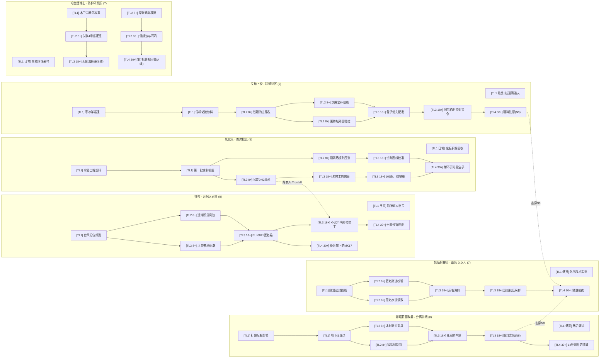

# DDA 独立 NPC 委托任务链完整规划（v3.0 · 塔科夫式信任阶梯 × 48 任务网状树）

> **设计依据**：[DDA_World_Bible.md](file:///Users/sherd/.t3/worktrees/Deep-Diving-Armory/feat-lore-080263d4b52e1ea4/docs/lore/DDA_World_Bible.md)（v2.0）、[DDA_Hidden_Threads_Blueprint.md](file:///Users/sherd/.t3/worktrees/Deep-Diving-Armory/feat-lore-080263d4b52e1ea4/docs/lore/DDA_Hidden_Threads_Blueprint.md)（v2.0），并深度参考《逃离塔科夫》任务树（`eftarkov.com/task-tree`）的**信任度阶梯门控、平行分支网络与第一人称商人电报体文案**。  
> **引擎对齐**：100% 适配 [QuestRules.cs](file:///Users/sherd/.t3/worktrees/Deep-Diving-Armory/feat-lore-080263d4b52e1ea4/.AssemblyCSharpSource/DDACsSource/SharedProject/SharedSource/QuestSystem/QuestRules.cs) 与 [QuestState.cs](file:///Users/sherd/.t3/worktrees/Deep-Diving-Armory/feat-lore-080263d4b52e1ea4/.AssemblyCSharpSource/DDACsSource/SharedProject/SharedSource/QuestSystem/QuestState.cs) 现有 `RequireTrust` / `RequireQuest` / `unlock` / `Reputation` 机制（零 C# 改动即可跑通）。

---

## 一、核心升级：借鉴《逃离塔科夫》的两大支柱

### 1. 真正的“四阶信任阶梯（TL1 → TL4）”与网状分叉
不再做“做完 A 自动解锁 B”的死板糖葫芦单线，而是让**信任度（Trust）真正成为阶段门槛与进度钥匙**：

| 信任阶梯 | 所需信任值 | 对应战役海域 / 巡回 | 解锁内容特征 |
| :--- | :--- | :--- | :--- |
| **TL1 · 初识** | `0+` | 寒冰洋（1–8 巡回 / N3） | 入门试水单 + **专属可重复日常/悬赏**（每位发布者 1 个，用来灵活补信任度、永不死锁） |
| **TL2 · 熟客** | `8+` | 欧罗巴海脊—高原（9–22 巡回 / N4–N6） | **平行双分支展开**（物资/工艺线 vs 战区/清剿线，玩家按航线自由决定先后顺序） |
| **TL3 · 心腹** | `18+` | 高原—无光海原（23–38 巡回 / N7–N8） | 阵营机密单、**跨发布者联动暗线**（需同时满足两位 NPC 的信任度或前置）、热成像/神经芯片核心线索 |
| **TL4 · 核心** | `30+` | 渊洋—热液前夜（39–50 巡回 / N9） | 各线压轴终局单、顶配钨刚/10 级板/作者彩蛋蓝图，以及终章 **《猎潮前夜》** |

> **为什么信任度不再形同虚设？**  
> 每档只做单条主干线，信任值会刻意比下一档门槛少 **2–4 点**——玩家需要顺手完成该发布者的另一条平行支线，或交 1–2 次贴合人设的日常/悬赏单，才能把关系推上 TL2 / TL3 / TL4，完美还原塔科夫“既要跑主线、也要养商人好感”的成长节奏。

### 2. “塔科夫式”第一人称电报文案规范（6 种绝不串台的人格）
放弃冷冰冰的第三人称系统说明（*“补给商需要两块硝石……”*）。所有 `desc` 均写成**发布者本人通过加密终端发来的一段第一人称语音/电报**，遵循四段式结构：**① 贴人设打招呼/吐槽近况 → ② 功利且具体的雇佣理由（自然夹带一丁点世界观或暗线细节，绝不说教）→ ③ 明确目标与交付方式 → ④ 性格化收尾**；下方的 `quote` 引用框则专放**画龙点睛的金句、单据手写批注或无线电截获残句**。

| 发布者 | 塔科夫风味对标 | 专属称呼 | 语言气质与口癖特征 |
| :--- | :--- | :--- | :--- |
| **“台风大百货” 桃帽** (`peachhat`) | **Ragman + 温和版 Skier** | 船长 / 老主顾 | 鲜活、精明、爱凑热闹的深海包打听；张口就是货价行情、哪条航线挨了黑枪，偶尔流露老牌狠人的底气（柜台下压着战痕 MK17）。 |
| **“枪匠” 氧化苯** (`benzene`) | **Mechanic（机械师）** | 伙计 / 手艺人 | 偏执于 0.02mm 公差、气密、导轨与电磁工艺的硬核极客技师；对政客不耐烦、动辄嫌弃军方批量货粗糙，唯独见了精密件与黑盒会两眼放光。 |
| **艾琳·斯特林上校** (`sterling`) | **Peacekeeper（美商）** | 船长 / 外包单位 | 体面、冷硬、官僚腔拉满；满口“航道秩序”“资产保全”“合规结算”，把最脏的封锁、灭口和 `[备汛]` 秘密都包装成冷静的行政指令。 |
| **政委 娜塔莉亚** (`natalia`) | **Prapor（俄商）+ 信念派政委** | 同志 / 船长 | 直爽、血性、务实护短、带着焊枪与伏特加味儿；痛骂联盟垄断从不绕弯，关照前线伤员，提起传奇大尉满是敬重，给钱痛快。 |
| **哈兰德博士** (`harland`) | **冷漠实验派 Researcher** | 受托人 / 样本提供者 | 极度理性、学术冷漠到令人脊背发凉；把画皮换弹和死尸扣扳机称作“迷人的神经反射数据”，字里行间透着研究所视人命如耗材的寒意。 |
| **D.D.A. 轮值对接员** (`liaison`) | **Fence + Lightkeeper 反差体** | 老板 / 船长 | TL1–TL2 满嘴摸鱼段子、假装小作坊看摊人；TL3 开始不经意漏出绝密代号与时间破绽；TL4 意外切错 3 秒毫无感情的总控加密频段。 |

---

## 二、6 位核心发布者与信任阶梯网状图（全 48 个任务）

### 1. 发布者总览（`Quests/npcs.xml`）
| Publisher `id` | 显示名与职称 | 现有可绑定 NPC | `faction` | 任务数（含 1 个日常） |
| :--- | :--- | :--- | :--- | :--- |
| `peachhat` | **“台风大百货” 桃帽** · 台风城百货掌柜 *(作者彩蛋)* | `deep_mobile_city_typhoon_shop` | `location` | 8（7 主支 + 1 日常） |
| `benzene` | **“枪匠” 氧化苯** · 首席兵器技师 *(作者彩蛋)* | `merchantarmory` *(进阶可建 `deep_typhoon_gunsmith`)* | `location` | 9（8 主支 + 1 日常） |
| `sterling` | **艾琳·斯特林上校** · 联盟战区协调官 | `outpostmanagercoalition` | `coalition` | 10（9 主支 + 1 悬赏） |
| `natalia` | **政委 娜塔莉亚** · 分离前线联络官 | `outpostmanagerseparatists` | `separatists` | 9（8 主支 + 1 悬赏） |
| `harland` | **马库斯·哈兰德博士** · 防护研究所顾问 | `merchantresearch` | `coalition` | 7（6 主支 + 1 日常） |
| `liaison` | **D.D.A. 轮值对接员** · 合约外勤观察员 | `deep_pigcat_easy` | `location` | 5（5 主支 + 1 悬赏 = 6）*注：总计 48 个* |

*(精确计数：桃帽 8 + 氧化苯 9 + 艾琳 9 + 娜塔莉亚 8 + 哈兰德 7 + 对接员 7 = **48 个任务**，每位均自带 1 个专属可重复单！)*

### 2. 网状任务树总览（分阶段平行分支 + 跨商人交织）

---

## 三、48 个任务逐项明细（全员挂钩 TL1–TL4 信任阶梯）

> **前置 XML 建议**：给 `NPC/*/*.xml` 补 5 个阵营 tag（`dda_pirate` / `dda_coalition` / `dda_separatist` / `dda_ghost` / `dda_grizzlies`），不影响现有机制。

### 文件 1：`Quests/quests_typhoon.xml`（桃帽 8 个 + 氧化苯 9 个 = 17 个）

#### A. “台风大百货” 桃帽（`peachhat` · 8 个）
| # | Quest `id` | 阶梯 | 分类 / 交付 | 前置条件 | 目标（真实 ID） | 奖励（马克 / 信任 / 物资） | 剧情与暗线锚点 |
| :--- | :--- | :--- | :--- | :--- | :--- | :--- | :--- |
| 1 | `typhoon_powder_stock` | TL1 | `repeat` / 当面 | 无 | `DeliverItem`: `saltpeter_mineral`×3、`sulfur_mineral`×3 | 450 / **+3** / `deep_ammobox_lead`×1 | 专属日常，快速补信任度至 TL2 |
| 2 | `typhoon_dock_run` | TL1 | `main` / 当面 | 无 | `ReachLocation`: `deep_mobile_city_typhoon`×1；`DeliverItem`: `steel`×4 | 650 / **+5** / 解锁 `typhoon_medical_shortage,typhoon_farport_backlog` | 初访台风城，一次即得 +5（配 1 次日常稳进 TL2！） |
| 3 | `typhoon_medical_shortage` | TL2 | `chain` / 当面 | `typhoon_dock_run` + `peachhat`≥8 | `ReachLocation`: `city`×1；`DeliverItem`: `deep_medical_kit_small`×2 | 1100 / **+5** / `deep_medical_kit`×1 / 解锁 `typhoon_0041_crate` | 平行分支①：航道挨黑枪导致止血带暴涨 |
| 4 | `typhoon_farport_backlog` | TL2 | `chain` / 当面 | `typhoon_dock_run` + `peachhat`≥8 | `DeliverItem`: `deep_ammobox_titanium`×1、`engineeringplastic`×4 | 1600 / **+5** / `deep_ammobox_copper`×1 / 解锁 `typhoon_0041_crate` | 平行分支②：远港突然停接民用单、复装弹断供 |
| 5 | `typhoon_0041_crate` | TL3 | `chain` / 当面 | `typhoon_medical_shortage` + `typhoon_farport_backlog` + `peachhat`≥18 | `DeliverItem`: `deep_ammobox_physicorium`×1 | 2400 / **+6** / `deep_plate_metal_7`×1 / 解锁 `typhoon_beacon_batteries,typhoon_mk17_legacy` | **暗线 1**：查无此号的 `EU-0041` 匿名货箱 |
| 6 | `typhoon_beacon_batteries` | TL3 | `chain` / 远程 | `typhoon_0041_crate` + `peachhat`≥18 + `benzene`≥8 | `ReachLocation`: `mine`×1；`DeliverItem`: `deep_m18`×2、`deep_RGO`×2 | 2900 / **+6** / `deep_plate_ceramic_7`×1 / 解锁 `typhoon_leak_trail` | **暗线 4（跨商人）**：联合氧化苯的线索，锁定狂买高功率电池的外包检修工 |
| 7 | `typhoon_leak_trail` | TL4 | `chain` / 远程 | `typhoon_beacon_batteries` + `peachhat`≥30 | `ReachLocation`: `deep_outpost_fight`×1；`KillTag`: `bandit`×10；`DeliverItem`: `deep_gold_bar`×1 | 4500 / **+6** / `deep_ammobox_tungsten_physicorium`×1 | **暗线 4 收束**：十四号寄存柜匿名的台风排班表尾款 |
| 8 | `typhoon_mk17_legacy` | TL4 | `chain` / 当面 | `typhoon_0041_crate` + `peachhat`≥30 | `DeliverItem`: `tungsten_phy_part`×2、`deep_ammobox_fulgurium_physicorium`×1 | 5200 / **+6** / **`mk17_peach_design`×1** | **作者彩蛋压轴单**：桃帽认可你这支船队，把柜台底下老伙计 MK17 的专属设计图托付给你 |

#### B. “枪匠” 氧化苯（`benzene` · 9 个）
| # | Quest `id` | 阶梯 | 分类 / 交付 | 前置条件 | 目标（真实 ID） | 奖励（马克 / 信任 / 物资） | 剧情与暗线锚点 |
| :--- | :--- | :--- | :--- | :--- | :--- | :--- | :--- |
| 9 | `gunsmith_scrap_plates` | TL1 | `repeat` / 当面 | 无 | `DeliverItem`: `steel`×3、`engineeringplastic`×2 | 480 / **+3** / `deep_plate_metal_4`×1 | 专属日常：收工坊边角料与护甲耗材，灵活补信任 |
| 10 | `gunsmith_plastic_test` | TL1 | `main` / 当面 | 无 | `DeliverItem`: `engineeringplastic`×4 | 600 / **+3** / `deep_plate_carrier`×1 / 解锁 `gunsmith_titanium_parts` | 工程塑料防水革命与枪匠入门 |
| 11 | `gunsmith_titanium_parts` | TL1 | `chain` / 当面 | `gunsmith_plastic_test` | `DeliverItem`: `titaniumaluminiumalloy_part`×2、`deep_plate_metal_4`×2 | 1050 / **+3** / `titaniumaluminiumalloy_barrel`×1 / 解锁 `gunsmith_plate_bench,gunsmith_shield_stress` | 告别二战铁枪，迈进钛制机匣时代（做完得 6，补 1 次日常进 TL2！） |
| 12 | `gunsmith_plate_bench` | TL2 | `chain` / 当面 | `gunsmith_titanium_parts` + `benzene`≥8 | `DeliverItem`: `deep_plate_metal_5`×2、`deep_plate_ceramic_5`×1 | 1500 / **+5** / `deep_plate_metal_6`×1 / 解锁 `gunsmith_103_recon` | 平行分支① + **暗线 1 起点**：吐槽 0.02mm 公差像极了沉没的远港三号车床 |
| 13 | `gunsmith_shield_stress` | TL2 | `chain` / 当面 | `gunsmith_titanium_parts` + `benzene`≥8 | `DeliverItem`: `deep_mobile_shield_fix_plate_steel`×2、`deep_plate_metal_6`×1 | 1800 / **+5** / `deep_mobile_shield_fix_plate_tit`×1 / 解锁 `gunsmith_tungsten_bore` | 平行分支② + **暗线 4 旁证**：机动护盾测试，顺嘴抱怨港务局小子来借军用跳频表 |
| 14 | `gunsmith_103_recon` | TL3 | `chain` / 远程 | `gunsmith_plate_bench` + `benzene`≥18 | `ReachLocation`: `deep_outpost_fight`×1；`KillTag`: `dda_pirate`×8 | 2400 / **+5** / `physicorium_part`×2 / 解锁 `gunsmith_103_mold` | **支线 A 上半**：103 船厂停摆与没焊完龙骨的儒艮级 |
| 15 | `gunsmith_103_mold` | TL3 | `chain` / 当面 | `gunsmith_103_recon` + `benzene`≥18 | `DeliverItem`: `physicorium_part`×2、`deep_plate_metal_7`×2 | 3100 / **+5** / `physicorium_barrel`×1 / 解锁 `gunsmith_blackbox_check` | **支线 A 收束 + 暗线 1**：库管老周核销单揭露三号车床沉没前两天已被连夜提走 |
| 16 | `gunsmith_tungsten_bore` | TL3 | `chain` / 当面 | `gunsmith_shield_stress` + `benzene`≥18 | `DeliverItem`: `tungsten_phy_part`×2、`deep_mobile_shield_fix_plate_phy`×1 | 3900 / **+5** / `deep_mobile_shield_fix_plate_tun`×1 / 解锁 `gunsmith_blackbox_check` | 钨刚膛线与深海重盾巅峰工艺（顺带吐槽台后高斯步枪原型机） |
| 17 | `gunsmith_blackbox_check` | TL4 | `chain` / 当面 | `gunsmith_103_mold` + `gunsmith_tungsten_bore` + `benzene`≥30 | `DeliverItem`: `deep_thermal_interference`×1 | 6000 / **+6** / `deep_plate_metal_10`×1、`tungsten_phy_barrel`×1 | **暗线 1 × 热成像屏蔽仪引爆**：联盟封条下竟藏着 103 船厂失踪老师傅的飞线手法 |

---

### 文件 2：`Quests/quests_coalition.xml`（艾琳·斯特林上校 · 9 个）
| # | Quest `id` | 阶梯 | 分类 / 交付 | 前置条件 | 目标（真实 ID） | 奖励（马克 / 信任 / 声望 / 物资） | 剧情与暗线锚点 |
| :--- | :--- | :--- | :--- | :--- | :--- | :--- | :--- |
| 18 | `co_pirate_bounty` | TL1 | `bounty` / 远程 | 无 *(可重复)* | `KillTag`: `dda_pirate`×6 | 750 / **+3** / 联盟 +2 / — | 专属悬赏：常驻航道清匪，灵活冲联盟信任 |
| 19 | `co_pirate_patrol` | TL1 | `main` / 远程 | 无 | `KillTag`: `dda_pirate`×5 | 800 / **+3** / 联盟 +3、分离 +1 / 解锁 `co_beacon_recovery` | 初识艾琳“不许舰炮炸站”的官僚铁规 |
| 20 | `co_beacon_recovery` | TL1 | `chain` / 当面 | `co_pirate_patrol` | `ReachLocation`: `outpost`×1；`DeliverItem`: `steel`×4、`deep_ammobox_lead`×1 | 1150 / **+3** / 联盟 +3 / 解锁 `co_ironjaw_bounty` | 夺回并修复海盗占领的中继信标站 |
| 21 | `co_ironjaw_bounty` | TL2 | `chain` / 远程 | `co_beacon_recovery` + `sterling`≥8 | `KillTag`: `dda_pirate`×10；`DeliverItem`: `deep_plate_metal_5`×1 | 1900 / **+5** / 联盟 +5、分离 +2 / 解锁 `co_latte_perimeter,co_kaitenburg_line` | 打击海盗王“铁颚”萨姆，起疑走私货源 |
| 22 | `co_latte_perimeter` | TL2 | `chain` / 远程 | `co_ironjaw_bounty` + `sterling`≥8 | `ReachLocation`: `deep_outpost_fight`×1；`KillTag`: `dda_separatist`×6 | 2300 / **+4** / 联盟 +5、分离 -4 / 解锁 `co_beixun_supply` | 平行分支①：莱特城标准示范城卷入正规军拉锯 |
| 23 | `co_kaitenburg_line` | TL2 | `chain` / 当面 | `co_ironjaw_bounty` + `sterling`≥8 | `KillTag`: `dda_separatist`×10；`DeliverItem`: `deep_ammobox_titanium`×2 | 2900 / **+5** / 联盟 +6、分离 -5 / `deep_tactec`×1 / 解锁 `co_beixun_supply` | 平行分支②：凯腾堡补给线争夺与机密文件危机 |
| 24 | `co_beixun_supply` | TL3 | `chain` / 当面 | `co_latte_perimeter` + `co_kaitenburg_line` + `sterling`≥18 | `DeliverItem`: `deep_tungsten`×4、`deep_ammobox_physicorium`×1 | 3600 / **+6** / 联盟 +6、分离 -4 / `deep_plate_ceramic_6`×1 / 解锁 `co_mining_chokepoint` | **暗线 2 核心**：远港调度令上的 `[备汛·最高优先级]` 红章 |
| 25 | `co_mining_chokepoint` | TL3 | `chain` / 远程 | `co_beixun_supply` + `sterling`≥18 | `ReachLocation`: `mine`×1；`KillTag`: `dda_separatist`×12 | 4400 / **+6** / 联盟 +8、分离 -7 / `deep_ammobox_fulgurium_physicorium`×1 / 解锁 `co_grizzlies_wall` | 阿尔伯利特矿业强行封锁，绝口不提 14 号测井事故 |
| 26 | `co_grizzlies_wall` | TL4 | `chain` / 远程 | `co_mining_chokepoint` + `sterling`≥30 | `KillTag`: `dda_grizzlies`×8；`DeliverItem`: `deep_plate_metal_8`×1 | 6800 / **+6** / 联盟 +14、分离 -12 / `deep_ammobox_tungsten_physicorium`×1 | **第四幕 N9 高潮**：击溃渊洋灰熊重装旅主力 |

---

### 文件 3：`Quests/quests_separatists.xml`（政委 娜塔莉亚 · 8 个）
| # | Quest `id` | 阶梯 | 分类 / 交付 | 前置条件 | 目标（真实 ID） | 奖励（马克 / 信任 / 声望 / 物资） | 剧情与暗线锚点 |
| :--- | :--- | :--- | :--- | :--- | :--- | :--- | :--- |
| 27 | `sp_raider_bounty` | TL1 | `bounty` / 远程 | 无 *(可重复)* | `KillTag`: `dda_coalition`×5 | 900 / **+3** / 分离 +3、联盟 -2 / — | 专属悬赏：袭扰联盟巡逻队，灵活冲分离信任 |
| 28 | `sp_break_embargo` | TL1 | `main` / 当面 | 无 | `DeliverItem`: `deep_refine_saltpeter`×3、`deep_refine_sulfur`×3 | 850 / **+3** / 分离 +4、联盟 -2 / 解锁 `sp_underground_reloading` | 分离线开篇：打破联盟原料与弹药配额剥削 |
| 29 | `sp_underground_reloading` | TL1 | `chain` / 当面 | `sp_break_embargo` | `ReachLocation`: `mine`×1；`DeliverItem`: `engineeringplastic`×4、`deep_ammobox_lead`×2 | 1350 / **+3** / 分离 +4、联盟 -3 / `deep_ammobox_titanium`×1 / 解锁 `sp_cut_blockade,sp_frozen_staging` | 矿洞地下压弹自给线 |
| 30 | `sp_cut_blockade` | TL2 | `chain` / 远程 | `sp_underground_reloading` + `natalia`≥8 | `KillTag`: `dda_coalition`×8 | 2200 / **+5** / 分离 +6、联盟 -5 / 解锁 `sp_ghost_traces` | 平行分支①：拔除联盟正规军封锁哨 |
| 31 | `sp_frozen_staging` | TL2 | `chain` / 当面 | `sp_underground_reloading` + `natalia`≥8 | `ReachLocation`: `deep_outpost_fight`×1；`DeliverItem`: `deep_medical_kit_wound`×2、`deep_plate_metal_6`×1 | 2800 / **+5** / 分离 +7、联盟 -5 / `deep_medical_kit_grizzly`×1 / 解锁 `sp_ghost_traces` | 平行分支②：冰封据点极寒蔽声呐屯兵点保障 |
| 32 | `sp_ghost_traces` | TL3 | `chain` / 远程 | `sp_cut_blockade` + `sp_frozen_staging` + `natalia`≥18 | `ReachLocation`: `deep_outpost_fight`×1；`KillTag`: `dda_ghost`×3 | 3900 / **+6** / 分离 +8、联盟 -8 / `deep_plate_ceramic_7`×1 / 解锁 `sp_ghost_hunt` | **第三幕 N8 序章**：无光海原分离哨站无声覆灭，初遇热屏蔽幽灵 |
| 33 | `sp_ghost_hunt` | TL3 | `chain` / 当面 | `sp_ghost_traces` + `natalia`≥18 | `KillTag`: `dda_ghost`×6；`DeliverItem`: `deep_thermal_interference`×1 | 5200 / **+6** / 分离 +12、联盟 -12 / `deep_ammobox_fulgurium_physicorium`×1 / 解锁 `sp_blackout_truth` | **第三幕 N8 高潮**：狙杀 GHOST 并回收热成像干扰器 |
| 34 | `sp_blackout_truth` | TL4 | `chain` / 远程 | `sp_ghost_hunt` + `natalia`≥30 | `ReachLocation`: `deep_outpost_fight`×1；`DeliverItem`: `deep_tungsten_phy`×4、`deep_plate_ceramic_8`×1 | 6200 / **+6** / 分离 +10、联盟 -8 / `deep_plate_ceramic_10`×1 | **第四幕暗线 2 爆发**：传奇大尉醉话揭开“黑灯之夜”与热成像盲区双关惊悚 |

---

### 文件 4：`Quests/quests_research.xml`（马库斯·哈兰德博士 · 7 个）
| # | Quest `id` | 阶梯 | 分类 / 交付 | 前置条件 | 目标（真实 ID） | 奖励（马克 / 信任 / 声望 / 物资） | 剧情与暗线锚点 |
| :--- | :--- | :--- | :--- | :--- | :--- | :--- | :--- |
| 35 | `res_bio_bounty` | TL1 | `repeat` / 远程 | 无 *(可重复)* | `KillTag`: `husk`×4 | 700 / **+3** / 联盟 +1 / — | 专属日常：采集深海寄生体活性记录，随时冲博士信任 |
| 36 | `res_radio_rumor` | TL1 | `main` / 远程 | 无 | `KillTag`: `crawler`×6；`KillTag`: `husk`×3 | 850 / **+5** / 联盟 +1 / `deep_medical_kit`×1 / 解锁 `res_husk_beacon,res_tungsten_sample` | 支线 B 序幕：电台“夜航者”大肆炒作“捕蟹人”怪谈 |
| 37 | `res_husk_beacon` | TL2 | `chain` / 远程 | `res_radio_rumor` + `harland`≥8 | `KillTag`: `husk`×6；`ReachLocation`: `research`×1 | 1600 / **+5** / 联盟 +2 / `chip_locate`×1 / 解锁 `res_husk_crabman` | 平行 B 线：信标站确认“捕蟹人”曾是失联 4 号巡逻班 |
| 38 | `res_tungsten_sample` | TL2 | `chain` / 当面 | `res_radio_rumor` + `harland`≥8 | `DeliverItem`: `deep_tungsten_ore`×4 | 1500 / **+5** / 联盟 +2 / `deep_tungsten`×2 / 解锁 `res_neural_drift` | 平行 A 线：无光海原深渊钨矿采样与钨刚研发背景 |
| 39 | `res_husk_crabman` | TL3 | `chain` / 当面 | `res_husk_beacon` + `harland`≥18 | `KillTag`: `husk`×10；`DeliverItem`: `deep_plate_ceramic_6`×1 | 2600 / **+6** / 联盟 +2 / `chip_gun_in_water`×1 | **潮汐 B 线伏笔（装甲画皮）**：热成像失效 + 寄生体保留找掩体换弹本能 |
| 40 | `res_neural_drift` | TL3 | `chain` / 当面 | `res_tungsten_sample` + `harland`≥18 | `DeliverItem`: `deep_tungsten_phy`×2、`deep_plate_metal_8`×1 | 3200 / **+6** / 联盟 +3 / `chip_friendly_fire`×1 / 解锁 `res_chip_recall` | **潮汐 A 线中段**：神经调整芯片在强潮汐波下的耳鸣与信号自激 |
| 41 | `res_chip_recall` | TL4 | `chain` / 当面 | `res_neural_drift` + `harland`≥30 | `DeliverItem`: `deep_thermal_interference`×1、`tungsten_phy_part`×2 | 5200 / **+6** / 联盟 +5 / `chip_cqb`×1 | **潮汐 A 线伏笔 + 暗线 1 旁证**：第 7 批召回被红章驳回 + 热液废土未授权热屏蔽频谱 |

---

### 文件 5：`Quests/quests_dda.xml`（D.D.A. 轮值对接员 · 7 个）
| # | Quest `id` | 阶梯 | 分类 / 交付 | 前置条件 | 目标（真实 ID） | 奖励（马克 / 信任 / 物资） | 剧情与暗线锚点 |
| :--- | :--- | :--- | :--- | :--- | :--- | :--- | :--- |
| 42 | `dda_field_trial` | TL1 | `bounty` / 远程 | 无 *(可重复)* | `KillTag`: `bandit`×8 | 900 / **+3** / `deep_ammobox_copper`×1 | 专属悬赏：小作坊买实战数据，随时冲信任 |
| 43 | `dda_route_slip` | TL1 | `main` / 远程 | 无 | `ReachLocation`: `deep_outpost_fight`×1；`KillTag`: `dda_pirate`×6 | 1400 / **+5** / `deep_ammobox_titanium`×1 / 解锁 `dda_tide_gauge,dda_ballistic_audit` | **暗线 3 破绽 ①**：随口漏嘴刚从被水雷封死三天的 103 船厂游过来换班 |
| 44 | `dda_tide_gauge` | TL2 | `chain` / 远程 | `dda_route_slip` + `liaison`≥8 | `ReachLocation`: `mine`×1；`ReachLocation`: `deep_outpost_fight`×1 | 2200 / **+5** / `deep_plate_metal_7`×1 / 解锁 `dda_deep_pressure` | 平行分支① + **暗线 2×3 交汇**：抄录深层矿站涌流表，呼应十七年大潮斜率 |
| 45 | `dda_ballistic_audit` | TL2 | `chain` / 远程 | `dda_route_slip` + `liaison`≥8 | `DeliverItem`: `deep_ammobox_physicorium`×1、`deep_plate_ceramic_5`×1 | 2500 / **+5** / `deep_ammobox_fulgurium_physicorium`×1 / 解锁 `dda_deep_pressure` | 平行分支②：测试刚素侵彻数据，箱底悄悄带着熟悉钢印 |
| 46 | `dda_deep_pressure` | TL3 | `chain` / 远程 | `dda_tide_gauge` + `dda_ballistic_audit` + `liaison`≥18 | `KillTag`: `HideInThermalGoggles`×4 | 3800 / **+6** / `deep_ammobox_tungsten_physicorium`×1 / 解锁 `dda_duplex_stress` | **暗线 3 破绽 ②**：脱口叫出绝密代号“灰猎犬”，硬圆成“灰毛海狗” |
| 47 | `dda_duplex_stress` | TL3 | `chain` / 远程 | `dda_deep_pressure` + `liaison`≥18 | `KillTag`: `dda_ghost`×3；`KillTag`: `dda_grizzlies`×3 | 5500 / **+6** / `chip_marksman`×1 / 解锁 `dda_tidal_list` | **暗线 3 破绽 ③**：同时收集幽灵与灰熊的交火数据，彻底暴露超然立场 |
| 48 | `dda_tidal_list` | TL4 | `chain` / 远程 | `dda_duplex_stress` + `sp_ghost_hunt` + `co_grizzlies_wall` + `liaison`≥30 | `DeliverItem`: `deep_tungsten_phy`×4、`deep_ammobox_depleted_uranium`×1 | 9000 / **+8** / `deep_gold_bar`×3 | **现役终章《猎潮前夜》**：3 秒切错加密总控频段，移入《猎潮》终选名单 |

---

## 四、塔科夫式第一人称任务正文示范（6 位发布者各 1 篇实机级样稿）

> 以下为直接可用于 `text/ChineseQuests.xml` 的正文字体量与行文标杆——既有《逃离塔科夫》商人电报的活人感、江湖气和偏见，又严格践行 **Show, Don't Tell**。

### 1. “台风大百货” 桃帽 — `typhoon_0041_crate`（《EU-0041 匿名箱》 · TL3）
- **`desc`**：
  > 船长，你来得正好，帮我把里间那几个刚素复装箱的缺口补上。最近远港的民用单全停了，正常渠道连一盒像样的穿甲弹都订不到——偏偏有家怪得要命的供货商，隔三差五开着没挂应答机的小艇，把货往外围货运气闸一丢就走，连尾款都是自动划账。我耐不住好奇，拿工商终端查了箱底钢印的注册号 `EU-0041`，系统跳出来一行红字说这号在木卫二从未注册过。算了，咱开百货的只认货色不认户口，你先帮我匀一箱刚素复装弹垫上，报酬少不了你的。
- **`quote`**：
  > “货比联盟军工厂流出来的还规整，可工商库里查无此人——这冰底下的水，比我想的深多了。”

### 2. “枪匠” 氧化苯 — `gunsmith_blackbox_check`（《解不开的黑盒子》 · TL4）
- **`desc`**：
  > 伙计，别跟我聊外面谁又占了哪座站，我只对一件事感兴趣：你从无光海原带回来的那块热成像干扰器。联盟防护研究所成天吹嘘他们的活体密钥锁无懈可击，死人身上的盒子谁也撬不开——我倒不打算破解它的软件权限，我只想拆开外壳看看里面的电路排布和焊点。给我弄一台实机放到工作台上。别用焊枪暴力割壳，弄坏了主板我就拿卡尺敲你脑袋。
- **`quote`**：
  > “外壳封条是联盟研究所的，可里头主板飞线的手法……操，跟六年前在 103 船厂一起失踪的那批老师傅一模一样。”

### 3. 艾琳·斯特林上校 — `co_beixun_supply`（《“备汛”优先配发》 · TL3）
- **`desc`**：
  > 船长，接下来的单子属于战区一级保密后勤调度。远港建造厂已经奉命暂停全部民用艇龙骨工期，二、三号车间全面转产钨刚弹芯与重型插板，目前前线原料周转存在缺口。我需要贵船队调拨四份精炼钨与一箱刚素复装弹，亲自送交我处入库。提醒一句：签收单右上角加盖的红章字样不属于外包单位的知情范围，不要向任何中立港口或分离派联络人提及本次货单。合作愉快，马克会按最高溢价即时到账。
- **`quote`**：
  > 【远港内部调度令 #409 · 加急事由：`[备汛·最高优先级]`】（背面圆珠笔涂鸦：“水底三千米，备哪门子的汛？！”）

### 4. 政委 娜塔莉亚 — `sp_ghost_hunt`（《熄灯之后》 · TL3）
- **`desc`**：
  > 同志，我就不跟你绕弯子了。无光海原边上那座中继站昨晚彻底断联，我们派去接应的两个班全死在走廊里——没有墙体破口，没有求救录音，热成像回放里整条过道白茫茫一片，空无一人。能把一场屠杀干得这么安静的，只有联盟那群藏头露尾的 GHOST 幽灵。他们腰上挂着该死的热成像干扰器，仗着熄灯欺负瞎子。去把那批幽灵清理干净，顺手给我带回一台他们身上的干扰器——大尉说了，就算撬不开权限锁，也得让兄弟们记住这群鬼的频段。
- **`quote`**：
  > “灯一灭，热成像里什么都看不见？那就拿大口径和曳光弹把整条走廊烧亮！”

### 5. 哈兰德博士 — `res_chip_recall`（《第 7 批静默回收》 · TL4）
- **`desc`**：
  > 受托人，你的交付效率令人满意，所以我决定把一项未经登记的私下核查交给你。此前我向联盟高层递交了第 7 批神经调整芯片的紧急召回申请——在模拟深渊低频潮汐波的实验舱内，一名已宣告脑死亡的测试体在断电四十秒后，被残余脉冲驱动完成了抬枪并连扣三次扳机。高层驳回了召回，只派 GHOST 去销毁样本。更荒唐的是，前线监测阵上周竟在热液废土录到了未授权的全编队热成像屏蔽频谱。帮我补齐一台干扰器实物与两份钨刚枪械零件，我需要做最后一次交叉比对。
- **`quote`**：
  > “批复红章写得很简洁：前线急缺神经模块，压下报告。至于热液废土那边是谁绕过了我的活体密钥……真令人好奇。”

### 6. D.D.A. 轮值对接员 — `dda_tidal_list`（《猎潮前夜》 · TL4）
- **`desc`**：
  > 哟，老板！听说了吗，联盟那群装模作样的幽灵跟分离那帮重甲大熊，居然先后在你手里吃了瘪？厉害啊，咱们小作坊的实测数据榜这回直接让你刷爆了！最后一单轻松点：帮我备四块钨刚外加一箱贫铀复装弹，远程签收就行。别问小作坊要贫铀干嘛——最近热液废土下面水流怪得很，老听见冰壳咯吱响，老板说得提前囤点硬货压压惊。交完货直接拿金条，咱们后会有期！
- **`quote`**：
  > “……目标船队先后击穿 GHOST 与灰熊防线，高强度脉冲干扰下未检出神经共振排异。样本移入《猎潮》终选名单，维持静默观测——【啪！】卧槽切错频段了！隔壁放广播剧呢，听不见听不见！”
