# DDA 独立 NPC 委托任务链完整规划（v2.0 · 44 任务长战役版）

> **设计依据**：[DDA_World_Bible.md](file:///Users/sherd/.t3/worktrees/Deep-Diving-Armory/feat-lore-080263d4b52e1ea4/docs/lore/DDA_World_Bible.md)（v2.0）与 [DDA_Hidden_Threads_Blueprint.md](file:///Users/sherd/.t3/worktrees/Deep-Diving-Armory/feat-lore-080263d4b52e1ea4/docs/lore/DDA_Hidden_Threads_Blueprint.md)（v2.0）  
> **引擎对齐**：100% 贴合 [QuestRules.cs](file:///Users/sherd/.t3/worktrees/Deep-Diving-Armory/feat-lore-080263d4b52e1ea4/.AssemblyCSharpSource/DDACsSource/SharedProject/SharedSource/QuestSystem/QuestRules.cs) 与 [QuestRuntime.cs](file:///Users/sherd/.t3/worktrees/Deep-Diving-Armory/feat-lore-080263d4b52e1ea4/.AssemblyCSharpSource/DDACsSource/SharedProject/SharedSource/QuestSystem/QuestRuntime.cs) 现有能力（零 C# 引擎改动即可运行）。  
> **战役节奏目标**：匹配《潜渊症》30–50 巡回的完整长战役跨度，将 6 位发布者的剧情线细化为 **44 个递进委托**——每一环都对应新的材料/弹药/插板/地标跃迁与一格新的世界观切片，零注水、零信任度死锁。

---

## 一、工程对接与海域巡回节奏总览

### 1. 五大海域巡回节奏映射
| 战役阶段 | 预计巡回 | 装备/弹药演进锚点 | 活跃任务数量 | 叙事与暗线推进重点 |
| :--- | :--- | :--- | :--- | :--- |
| **寒冰洋（N3）** | 第 1–8 巡回 | 硝石/硫磺、钢材、工程塑料、铅弹、3–4 级板 | 8 个 | 认识 6 位发布者、台风城停靠、浅层海盗清剿、捕蟹人电台初现 |
| **欧罗巴海脊（N4–N5）** | 第 9–18 巡回 | 钛制枪械零件、钛弹、5 级板、精炼火药 | 10 个 | 打击海盗王、远港三号车床公差疑云、失联 4 号巡逻班、103 封锁线口误、初进莱特城 |
| **高原（N6–N7）** | 第 19–28 巡回 | 刚素零件/弹箱、6–7 级板、机动护盾加固板 | 11 个 | 远港断供、`EU-0041` 匿名货箱、103 船厂核销单、凯腾堡与冰封据点拉锯、`[备汛]` 急件、无体温换弹画皮 |
| **无光海原（N8）** | 第 29–38 巡回 | 深渊钨矿、精炼钨、雷刚弹、8 级板、热成像屏蔽仪 | 8 个 | 港务电池与跳频表线索、阿尔伯利特矿区封锁、GHOST 幽灵行动、“灰毛海狗”口误、神经芯片低频自激 |
| **渊洋—热液前夜（N9）** | 第 39–50 巡回 | 钨刚、钨刚枪管、9–10 级板、贫铀弹 | 7 个 | 14 号寄存柜内鬼收束、氧化苯拆检热成像屏蔽仪、灰熊重装旅决战、黑灯之夜真相、**《猎潮前夜》3 秒切错频段** |

### 2. 唯一建议补齐的轻量 XML 前置项
目前 `NPC/*/*.xml` 中所有人类敌人 `tags` 统一只有 `bandit`（及精英的 `HideInThermalGoggles`）。落地前仅需给五大敌对势力补 5 个轻量阵营 tag（不影响现有任何机制）：
- `dda_pirate`（海盗）、`dda_coalition`（联盟敌军）、`dda_separatist`（分离敌军）、`dda_ghost`（GHOST 幽灵）、`dda_grizzlies`（灰熊重装旅）。

---

## 二、6 位核心发布者规划（`Quests/npcs.xml`）

| Publisher `id` | 角色名与定位 | 现有可绑定 NPC（开箱即用） | `faction` | 任务数 | 负责的主线 / 暗线职责 |
| :--- | :--- | :--- | :--- | :--- | :--- |
| `peachhat` | **“台风大百货” 桃帽** *(模组作者彩蛋)* | `npcIdentifier="deep_mobile_city_typhoon_shop"` | `location` | 7 | 台风城生态、日常火药补给、**暗线 1（`EU-0041`）**、**暗线 4（十四号寄存柜内鬼）** |
| `benzene` | **“枪匠” 氧化苯** *(模组作者彩蛋)* | `npcIdentifier="merchantarmory"` *(进阶可在台风城新增 `deep_typhoon_gunsmith`)* | `location` | 8 | 四代枪械/插板/护盾工艺、**支线 A（103 船厂模具）**、**暗线 1（远港车床 + 拆检热屏蔽仪）** |
| `sterling` | **艾琳·斯特林上校**（联盟战区协调官） | `npcIdentifier="outpostmanagercoalition"` | `coalition` | 9 | **第一幕海盗 → 第二幕莱特/凯腾堡 → `[备汛]` 急件 → 阿尔伯利特封锁 → 第四幕灰熊（N9）** |
| `natalia` | **政委 娜塔莉亚**（分离前线联络官） | `npcIdentifier="outpostmanagerseparatists"` | `separatists` | 8 | **打破禁运 → 冰封据点 → 第三幕 GHOST 幽灵（N8）→ 第四幕黑灯之夜真相** |
| `harland` | **马库斯·哈兰德博士**（防护研究所顾问） | `npcIdentifier="merchantresearch"` | `coalition` | 6 | **支线 B 捕蟹人三部曲（潮汐 B 线伏笔）** + **深渊钨矿与第 7 批神经芯片自激（潮汐 A 线伏笔）** |
| `liaison` | **D.D.A. 轮值对接员**（“先辈” / 匿名接线员） | `npcIdentifier="deep_pigcat_easy"` *(后续可并入合约室 NPC)* | `location` | 6 | 战地实测悬赏、**暗线 3（103 封锁线口误 → 灰毛海狗 → 双线采样 → 《猎潮前夜》3 秒切错频段）** |

---

## 三、任务链总拓扑图（6 条主干 · 44 个任务）

```mermaid
flowchart LR
    subgraph TY1["台风大百货 · 桃帽 (7)"]
        M1["M1 铅弹底火补货<br/>(repeat)"]
        M2["M2 台风泊位报到"] --> M3["M3 止血带涨价潮"] --> M4["M4 远港断货风波"] --> M5["M5 EU-0041匿名箱"] --> M6["M6 不买声呐的检修工"] --> M7["M7 十四号寄存柜"]
    end

    subgraph TY2["枪匠线 · 氧化苯 (8)"]
        C1["C1 水密工程塑料"] --> C2["C2 钛制机匣"] --> C3["C3 公差0.02毫米"] --> C4["C4 未完工的儒艮"] --> C5["C5 103核销单"] --> C6["C6 刚素盾板耐压测"] --> C7["C7 钨刚膛线校准"] --> C8["C8 解不开的黑盒子"]
    end

    subgraph CO["联盟线 · 艾琳上校 (9)"]
        S1["S1 航道巡逻"] --> S2["S2 信标抢修料"] --> S3["S3 铁颚的过路税"] --> S4["S4 莱特城外围"] --> S5["S5 凯腾堡补给线"] --> S6["S6 备汛优先配发"] --> S7["S7 阿尔伯利特封锁"] --> S8["S8 铁幕试探"] --> S9["S9 砸碎铁幕(N9)"]
    end

    subgraph SP["分离线 · 娜塔莉亚政委 (8)"]
        N1["N1 打破配额封锁"] --> N2["N2 地下压弹点"] --> N3["N3 拔除封锁哨"] --> N4["N4 冰封洞穴屯兵"] --> N5["N5 死寂的哨站"] --> N6["N6 熄灯之后(N8)"] --> N7["N7 大尉的酒壶"] --> N8["N8 14号测井的铁罐"]
    end

    subgraph RE["防护研究所 · 哈兰德 (6)"]
        H1["H1 木卫二睡前故事"] --> H2["H2 失联4号巡逻班"] --> H3["H3 无体温换弹(B线)"]
        H4["H4 深渊硬度极限"] --> H5["H5 低频波与耳鸣"] --> H6["H6 第7批静默回收(A线)"]
    end

    subgraph DDA["幕后黑箱 · D.D.A. 对接员 (6)"]
        D1["D1 外围战地实测<br/>(bounty)"] --> D2["D2 刚游过封锁线"] --> D3["D3 无名水流读数"] --> D4["D4 灰毛海狗"] --> D5["D5 双线抗压采样"] --> D6["D6 猎潮前夜"]
    end

    C2 -.->|"跨线信任"| M6
    N6 -.->|"跨线解锁"| D6
    S9 -.->|"跨线解锁"| D6
```

---

## 四、44 个任务逐项设计明细（全部核对真实 ID 与信任度无死锁）

### 文件 1：`Quests/quests_typhoon.xml`（台风城 · 桃帽 7 个 + 氧化苯 8 个 = 15 个）

#### A. “台风大百货” 桃帽（`peachhat`）—— 商路、民生与台风内鬼 *(作者彩蛋)*
| # | Quest `id` | 海域 | 分类 / 交付 | 前置条件 | 目标（真实 ID） | 奖励与声望 | 叙事切片 & `quote` 语录 |
| :--- | :--- | :--- | :--- | :--- | :--- | :--- | :--- |
| 1 | `typhoon_powder_stock` | 寒冰洋 | `repeat` / 当面 | 无 | `DeliverItem`: `saltpeter_mineral` ×3、`sulfur_mineral` ×3 | 450 马克、信任 +2、`deep_ammobox_lead` ×1 | 浅层火药短缺日常周转。*“前线又在拿铅弹泼水了，有多少硝石硫磺台风大百货全吃。”* |
| 2 | `typhoon_dock_run` | 寒冰洋 | `main` / 当面 | 无 | `ReachLocation`: `deep_mobile_city_typhoon` ×1；`DeliverItem`: `steel` ×4 | 600 马克、信任 +3、解锁 `typhoon_medical_shortage` | 引导初访台风移动城市。*“停稳了就来柜台报个到，台风号不问出处，只认货和马克。”* |
| 3 | `typhoon_medical_shortage` | 海脊 | `chain` / 当面 | `typhoon_dock_run` | `ReachLocation`: `city` ×1；`DeliverItem`: `deep_medical_kit_small` ×2 | 950 马克、信任 +3、`deep_medical_kit` ×1、解锁 `typhoon_farport_backlog` | 战火外溢导致殖民地止血带断货。*“上周三艘运货艇刚过海脊就挨了黑枪，现在绷带比威士忌还好卖。”* |
| 4 | `typhoon_farport_backlog` | 高原 | `chain` / 当面 | `typhoon_medical_shortage` + `peachhat`≥6 | `DeliverItem`: `deep_ammobox_titanium` ×1、`engineeringplastic` ×4 | 1500 马克、信任 +3、`deep_ammobox_copper` ×1、解锁 `typhoon_0041_crate` | 引出远港停造民用艇、货源断供。*“远港那边突然停了所有民用单子，连台风大百货都得拆旧箱子凑复装弹。”* |
| 5 | `typhoon_0041_crate` | 高原 | `chain` / 当面 | `typhoon_farport_backlog` + `peachhat`≥9 | `DeliverItem`: `deep_ammobox_physicorium` ×1 | 2100 马克、信任 +4、`deep_plate_metal_7` ×1、解锁 `typhoon_beacon_batteries` | **暗线 1**：查无此号的 `EU-0041` 匿名箱。*“箱底印着 EU-0041，工商终端却说这号从未存在过——管它呢，货比军方的还规整。”* |
| 6 | `typhoon_beacon_batteries` | 无光 | `chain` / 远程 | `typhoon_0041_crate` + `benzene`≥6 | `ReachLocation`: `mine` ×1；`DeliverItem`: `deep_m18` ×2、`deep_RGO` ×2 | 2600 马克、信任 +4、`deep_plate_ceramic_7` ×1、解锁 `typhoon_leak_trail` | **暗线 4 中段**：外包检修工狂买高功率信标电池却不买声呐。*“港务局新来的外包工怪得很，专挑长距水下信标电池扫货，出手比船长还阔绰。”* |
| 7 | `typhoon_leak_trail` | 渊洋 | `chain` / 远程 | `typhoon_beacon_batteries` + `peachhat`≥16 | `ReachLocation`: `deep_outpost_fight` ×1；`KillTag`: `bandit` ×10；`DeliverItem`: `deep_gold_bar` ×1 | 3800 马克、信任 +5、`deep_ammobox_tungsten_physicorium` ×1 *(可选彩蛋加赠 `mk17_peach_design`)* | **暗线 4 收束**：排班表尾款指向台风大百货 14 号匿名寄存柜。*“十四号柜那个匿名租户再也没露过面……老霍尔姆要是知道，准得把人塞进鱼雷管。”* |

#### B. “枪匠” 氧化苯（`benzene`）—— 枪械演化、103 船厂旧账与黑盒拆检 *(作者彩蛋)*
| # | Quest `id` | 海域 | 分类 / 交付 | 前置条件 | 目标（真实 ID） | 奖励与声望 | 叙事切片 & `quote` 语录 |
| :--- | :--- | :--- | :--- | :--- | :--- | :--- | :--- |
| 8 | `gunsmith_plastic_test` | 寒冰洋 | `main` / 当面 | 无 | `DeliverItem`: `engineeringplastic` ×4 | 550 马克、信任 +3、`deep_plate_carrier` ×1、解锁 `gunsmith_titanium_parts` | 工程塑料防水革命与枪匠入门。*“在两千米水压下，卡壳半秒就够画皮把你肋骨拆下来当笛子吹了。”* |
| 9 | `gunsmith_titanium_parts` | 海脊 | `chain` / 当面 | `gunsmith_plastic_test` | `DeliverItem`: `titaniumaluminiumalloy_part` ×2、`deep_plate_metal_4` ×2 | 1000 马克、信任 +3、`titaniumaluminiumalloy_barrel` ×1、解锁 `gunsmith_plate_bench` | 现代轻量化钛件替代二战铁疙瘩。*“别留恋那些老掉牙的铁管子了，换上钛铝合金机匣，你的手腕会谢谢你。”* |
| 10 | `gunsmith_plate_bench` | 海脊 | `chain` / 当面 | `gunsmith_titanium_parts` + `benzene`≥6 | `DeliverItem`: `deep_plate_metal_5` ×2、`deep_plate_ceramic_5` ×1 | 1400 马克、信任 +3、`deep_plate_metal_6` ×1、解锁 `gunsmith_103_recon` | **暗线 1 起点**：吐槽 0.02mm 导轨公差像极了沉没的远港三号车床。*“这倒角公差只有远港三号车床铣得出来——可它六年前就在 103 船厂登记沉没了，怪事。”* |
| 11 | `gunsmith_103_recon` | 高原 | `chain` / 远程 | `gunsmith_plate_bench` + `benzene`≥9 | `ReachLocation`: `deep_outpost_fight` ×1；`KillTag`: `dda_pirate` ×8 | 1900 马克、信任 +3、`deep_mobile_shield_fix_plate_tit` ×1、解锁 `gunsmith_103_mold` | **支线 A 上半**：回忆 103 超钢船厂停摆与未完工的儒艮级潜艇。*“我走那天那艘儒艮龙骨还没焊完，现在倒好，全成了海盗藏军火的窟窿。”* |
| 12 | `gunsmith_103_mold` | 高原 | `chain` / 当面 | `gunsmith_103_recon` + `benzene`≥12 | `DeliverItem`: `physicorium_part` ×2、`deep_mobile_shield_fix_plate_steel` ×2 | 2500 马克、信任 +4、`physicorium_barrel` ×1、解锁 `gunsmith_shield_stress` | **支线 A 收束 + 暗线 1**：库管老周称三号车床沉没前两天被“深潜物流”提走。*“老周在核销单背面写了行铅笔字——三号车床压根没沉，是被人拿上面签的放行条连夜吊走的。”* |
| 13 | `gunsmith_shield_stress` | 无光 | `chain` / 当面 | `gunsmith_103_mold` + `benzene`≥16 | `DeliverItem`: `deep_plate_metal_7` ×2、`deep_mobile_shield_fix_plate_phy` ×1 | 3200 马克、信任 +4、`deep_plate_ceramic_8` ×1、解锁 `gunsmith_tungsten_bore` | 机动护盾刚素强化 + **暗线 4 旁证**（港务员来借军用跳频表）。*“对了，上周有个港务局小子来借旧版军用跳频表，说是修压载舱信号灯——修信号灯用得着跳频？”* |
| 14 | `gunsmith_tungsten_bore` | 渊洋 | `chain` / 当面 | `gunsmith_shield_stress` + `benzene`≥20 | `DeliverItem`: `tungsten_phy_part` ×2、`tungsten_phy_barrel` ×1 | 4200 马克、信任 +4、`deep_mobile_shield_fix_plate_tun` ×1、解锁 `gunsmith_blackbox_check` | 钨刚材料学巅峰体验。*“精炼钨掺刚素，车刀报废三把才磨出一根膛线——但打穿十级板的那一刻，值了。”* |
| 15 | `gunsmith_blackbox_check` | 渊洋 | `chain` / 当面 | `gunsmith_tungsten_bore` + `benzene`≥24 | `DeliverItem`: `deep_thermal_interference` ×1 | 5500 马克、信任 +6、`deep_plate_metal_10` ×1 | **暗线 1 × 热成像屏蔽仪引爆**：拆检缴获的 GHOST 热成像干扰器。*“外壳是联盟研究所的封条，可里头主板飞线的手法……操，跟 103 船厂失踪那批老师傅一模一样。”* |

---

### 文件 2：`Quests/quests_coalition.xml`（联盟 · 艾琳·斯特林上校，9 个）

| # | Quest `id` | 海域 | 分类 / 交付 | 前置条件 | 目标（真实 ID） | 奖励与声望 | 叙事切片 & `quote` 语录 |
| :--- | :--- | :--- | :--- | :--- | :--- | :--- | :--- |
| 16 | `co_pirate_patrol` | 寒冰洋 | `main` / 远程 | 无 | `KillTag`: `dda_pirate` ×5 | 750 马克、信任 +3、联盟 +3、分离 +1、解锁 `co_beacon_recovery` | **第一幕开篇**：浅层清剿与“禁用舰炮炸站”铁规。*“联盟付你马克是为了完整收回哨站，不是看你把反应堆炸成废铁。”* |
| 17 | `co_beacon_recovery` | 寒冰洋 | `chain` / 当面 | `co_pirate_patrol` | `ReachLocation`: `outpost` ×1；`DeliverItem`: `steel` ×4、`deep_ammobox_lead` ×1 | 1100 马克、信任 +3、联盟 +3、解锁 `co_ironjaw_bounty` | 对应短兵相接：夺回并修补被海盗占据的中继信标站。*“信标站一瘫痪，整条浅层航线就成了瞎子。先稳住后勤，再谈清巢。”* |
| 18 | `co_ironjaw_bounty` | 海脊 | `chain` / 远程 | `co_beacon_recovery` + `sterling`≥6 | `KillTag`: `dda_pirate` ×10；`DeliverItem`: `deep_plate_metal_5` ×1 | 1800 马克、信任 +4、联盟 +5、分离 +2、解锁 `co_latte_perimeter` | **第一幕高潮**：打击海盗王“铁颚”萨姆，起疑背后放货源头。*“一个矿业保安出身的逃犯，哪来的成箱制式步枪和芳纶插板？清干净，把货扣下来。”* |
| 19 | `co_latte_perimeter` | 海脊 | `chain` / 远程 | `co_ironjaw_bounty` + `sterling`≥10 | `ReachLocation`: `deep_outpost_fight` ×1；`KillTag`: `dda_separatist` ×6 | 2200 马克、信任 +3、联盟 +5、分离 -4、解锁 `co_kaitenburg_line` | **第二幕开端**：莱特城等示范城市卷入正规军拉锯。*“泰勒·莱特修这些标准城是为了让人类体面活下去，不是给分离分子当掩体用的。”* |
| 20 | `co_kaitenburg_line` | 高原 | `chain` / 当面 | `co_latte_perimeter` + `sterling`≥13 | `KillTag`: `dda_separatist` ×10；`DeliverItem`: `deep_ammobox_titanium` ×2 | 2800 马克、信任 +4、联盟 +6、分离 -5、`deep_tactec` ×1、解锁 `co_beixun_supply` | 呼应“兵戎相见”凯腾堡争夺与机密文件外泄。*“凯腾堡丢了两次，我们不能再丢第三次。备齐弹药，把分离主力顶出航线中心。”* |
| 21 | `co_beixun_supply` | 高原 | `chain` / 当面 | `co_kaitenburg_line` + `sterling`≥17 | `DeliverItem`: `deep_tungsten` ×4、`deep_ammobox_physicorium` ×1 | 3400 马克、信任 +4、联盟 +6、分离 -4、`deep_plate_ceramic_6` ×1、解锁 `co_mining_chokepoint` | **暗线 2 核心**：远港紧急调度令上的 **`[备汛·最高优先级]`** 红章。*“单子上印的‘备汛’二字不用你理解，也别跟外人提。把钨料交齐，领钱走人。”* |
| 22 | `co_mining_chokepoint` | 无光 | `chain` / 远程 | `co_beixun_supply` + `sterling`≥21 | `ReachLocation`: `mine` ×1；`KillTag`: `dda_separatist` ×12 | 4000 马克、信任 +4、联盟 +8、分离 -7、`deep_ammobox_fulgurium_physicorium` ×1、解锁 `co_grizzlies_probe` | 阿尔伯利特矿业全面封锁，严禁外船靠近 14 号测井。*“阿尔伯利特的钨脉决定了谁能撑过下一个十年。至于 14 号井封舱的理由——那不在你的权限内。”* |
| 23 | `co_grizzlies_probe` | 渊洋 | `chain` / 远程 | `co_mining_chokepoint` + `sterling`≥25 | `KillTag`: `dda_grizzlies` ×4；`DeliverItem`: `deep_plate_metal_8` ×1 | 4800 马克、信任 +5、联盟 +10、分离 -8、`deep_plate_metal_9` ×1、解锁 `co_grizzlies_wall` | **第四幕序章**：初次遭遇灰熊重装旅与防水重甲压迫感。*“普通穿甲弹打在灰熊主宰身上跟敲铁皮差不多。带回实战损伤样本，总部要重新核算弹药配额。”* |
| 24 | `co_grizzlies_wall` | 渊洋 | `chain` / 远程 | `co_grizzlies_probe` + `sterling`≥30 | `KillTag`: `dda_grizzlies` ×8 | 6500 马克、信任 +6、联盟 +14、分离 -12、`deep_ammobox_tungsten_physicorium` ×1 | **第四幕 N9 高潮**：击溃渊洋灰熊主力，夺回通道。*“灰熊大尉占着渊洋口不肯退。不管他们从 14 号矿井底下看到了什么，绝不能让他们把通道炸开。”* |

---

### 文件 3：`Quests/quests_separatists.xml`（分离主义 · 政委 娜塔莉亚，8 个）

| # | Quest `id` | 海域 | 分类 / 交付 | 前置条件 | 目标（真实 ID） | 奖励与声望 | 叙事切片 & `quote` 语录 |
| :--- | :--- | :--- | :--- | :--- | :--- | :--- | :--- |
| 25 | `sp_break_embargo` | 寒冰洋 | `main` / 当面 | 无 | `DeliverItem`: `deep_refine_saltpeter` ×3、`deep_refine_sulfur` ×3 | 850 马克、信任 +3、分离 +4、联盟 -2、解锁 `sp_underground_reloading` | 分离线开篇：打破联盟原料配额垄断。*“联盟管我们叫叛军，可这冰盖下每一米管道都是矿工拿命焊出来的。”* |
| 26 | `sp_underground_reloading` | 海脊 | `chain` / 当面 | `sp_break_embargo` | `ReachLocation`: `mine` ×1；`DeliverItem`: `engineeringplastic` ×4、`deep_ammobox_lead` ×2 | 1300 马克、信任 +3、分离 +4、联盟 -3、`deep_ammobox_titanium` ×1、解锁 `sp_cut_blockade` | 矿工与船厂老技师搭起地下压弹自给线。*“远港的产线被联盟锁死了，我们就用矿洞里的旧机床自己压子弹。”* |
| 27 | `sp_cut_blockade` | 高原 | `chain` / 远程 | `sp_underground_reloading` + `natalia`≥6 | `KillTag`: `dda_coalition` ×6 | 2000 马克、信任 +4、分离 +6、联盟 -5、解锁 `sp_frozen_staging` | 正规军正面交锋，拔除联盟封锁哨。*“他们把民用船坞全改成了弹药厂，却连一颗平价子弹都不肯卖给独立船队。”* |
| 28 | `sp_frozen_staging` | 高原 | `chain` / 当面 | `sp_cut_blockade` + `natalia`≥10 | `ReachLocation`: `deep_outpost_fight` ×1；`KillTag`: `dda_coalition` ×10；`DeliverItem`: `deep_medical_kit_wound` ×2 | 2900 马克、信任 +4、分离 +7、联盟 -6、`deep_medical_kit_grizzly` ×1、解锁 `sp_ghost_traces` | 引出冰封据点极寒蔽声呐屯兵点与医疗保障。*“零下水域能挡住联盟声呐，可也冻坏了不少小伙子的手。把创伤包送进去，下一仗会很惨。”* |
| 29 | `sp_ghost_traces` | 无光 | `chain` / 远程 | `sp_frozen_staging` + `natalia`≥14 | `ReachLocation`: `deep_outpost_fight` ×1；`KillTag`: `dda_ghost` ×3 | 3800 马克、信任 +4、分离 +8、联盟 -8、`deep_plate_ceramic_7` ×1、解锁 `sp_ghost_hunt` | **第三幕 N8 序章**：无光海原分离哨站一夜无声覆灭，初遇热屏蔽幽灵。*“没有求救信号，没有墙体破口，热成像回放里整条走廊空无一人——那是 GHOST 动手了。”* |
| 30 | `sp_ghost_hunt` | 无光 | `chain` / 当面 | `sp_ghost_traces` + `natalia`≥18 | `KillTag`: `dda_ghost` ×6；`DeliverItem`: `deep_thermal_interference` ×1 | 5000 马克、信任 +5、分离 +12、联盟 -12、`deep_ammobox_fulgurium_physicorium` ×1、解锁 `sp_blackout_vodka` | **第三幕 N8 高潮**：狙杀幽灵并回收绝密热成像屏蔽仪。*“带回一台他们腰上的干扰器。大尉说就算撬不开权限锁，也得让兄弟们记住它的频段。”* |
| 31 | `sp_blackout_vodka` | 渊洋 | `chain` / 当面 | `sp_ghost_hunt` + `natalia`≥23 | `DeliverItem`: `deep_tungsten` ×4、`deep_plate_ceramic_8` ×1 | 4600 马克、信任 +4、分离 +6、联盟 -4、`deep_plate_metal_9` ×1、解锁 `sp_blackout_truth` | 过渡揭秘“黑灯之夜”大尉摔碎目镜、用曳光弹烧亮走廊的惨烈反推。*“大尉当年就是把瞎了的热成像砸在地上，吼着让机枪手拿燃烧瓶把走廊点亮，才从幽灵手里活下来的。”* |
| 32 | `sp_blackout_truth` | 渊洋 | `chain` / 远程 | `sp_blackout_vodka` + `natalia`≥27 | `ReachLocation`: `deep_outpost_fight` ×1；`DeliverItem`: `deep_tungsten_phy` ×4 | 5800 马克、信任 +6、分离 +10、联盟 -8、`deep_plate_ceramic_10` ×1 | **第四幕暗线 2 爆发**：热成像里同样没有体温的，不止是幽灵，还有从 14 号井捞上来的“死人”。*“火光炸开那一刻，连幽灵都在往那三个抽搐的铁罐子泼铝热剂……同志，大潮要来了，备好穿甲弹。”* |

---

### 文件 4：`Quests/quests_research.xml`（联盟防护研究所 · 马库斯·哈兰德博士，6 个）

| # | Quest `id` | 海域 | 分类 / 交付 | 前置条件 | 目标（真实 ID） | 奖励与声望 | 叙事切片 & `quote` 语录 |
| :--- | :--- | :--- | :--- | :--- | :--- | :--- | :--- |
| 33 | `res_radio_rumor` | 寒冰洋 | `main` / 远程 | 无 | `KillTag`: `crawler` ×6；`KillTag`: `husk` ×3 | 800 马克、信任 +3、联盟 +1、`deep_medical_kit` ×1、解锁 `res_husk_beacon` | **支线 B 序幕**：木卫二广播电台炒作“捕蟹人”怪谈。*“电台那个蠢货把任何怪声都编成捕蟹人传说——去清理干净，顺便传回寄生体活性读数。”* |
| 34 | `res_husk_beacon` | 海脊 | `chain` / 远程 | `res_radio_rumor` | `KillTag`: `husk` ×6；`ReachLocation`: `research` ×1 | 1500 马克、信任 +3、联盟 +2、`chip_locate` ×1、解锁 `res_husk_crabman` | **支线 B 中段**：信标站残骸确认“捕蟹人”曾是失联的 4 号巡逻班。*“那块划伤的陶瓷插板属于上周失联的 4 号班老马。画皮寄生了他们，却没让他们松开护木。”* |
| 35 | `res_husk_crabman` | 高原 | `chain` / 当面 | `res_husk_beacon` + `harland`≥6 | `KillTag`: `husk` ×10；`DeliverItem`: `deep_plate_ceramic_6` ×1 | 2400 马克、信任 +4、联盟 +2、`chip_gun_in_water` ×1 | **潮汐 B 线伏笔（装甲画皮）**：热成像失效 + 寄生体懂得找掩体换弹。*“热成像对画皮天然失效——更迷人的是，现场弹壳分布证明受寄生体完成了两次标准换弹。”* |
| 36 | `res_tungsten_sample` | 无光 | `main` / 当面 | 无 | `DeliverItem`: `deep_tungsten_ore` ×4 | 1400 马克、信任 +3、联盟 +2、`deep_tungsten` ×2、解锁 `res_neural_drift` | **钨刚技术线开篇**：无光海原深渊钨矿的战略价值。*“硬度胜过钻石，也比任何和平条约都管用。把原矿放下，别碰台面上的培养皿。”* |
| 37 | `res_neural_drift` | 无光 | `chain` / 当面 | `res_tungsten_sample` | `DeliverItem`: `deep_tungsten_phy` ×2、`deep_plate_metal_8` ×1 | 3000 马克、信任 +4、联盟 +3、`chip_friendly_fire` ×1、解锁 `res_chip_recall` | **潮汐 A 线中段**：神经调整芯片在深渊潮位异常期的耳鸣与信号漂移。*“一秒完成三秒的肌肉记忆，代价不过是轻微耳鸣和梦魇——相比被钨刚弹掀开天灵盖，很划算。”* |
| 38 | `res_chip_recall` | 渊洋 | `chain` / 当面 | `res_neural_drift` + `harland`≥7 | `DeliverItem`: `deep_thermal_interference` ×1、`tungsten_phy_part` ×2 | 4600 马克、信任 +5、联盟 +5、`chip_cqb` ×1 | **潮汐 A 线伏笔 + 暗线 1 旁证**：第 7 批召回被驳回 + 热液废土未授权热屏蔽信号。*“低频潮汐波让脑死亡受试者自己扣了三次扳机，上面却只叫 GHOST 烧样本……对了，热液废土哪来的未授权同频屏蔽信号？”* |

---

### 文件 5：`Quests/quests_dda.xml`（幕后黑箱 D.D.A. · 轮值对接员，6 个）

| # | Quest `id` | 海域 | 分类 / 交付 | 前置条件 | 目标（真实 ID） | 奖励与声望 | 叙事切片 & `quote` 语录 |
| :--- | :--- | :--- | :--- | :--- | :--- | :--- | :--- |
| 39 | `dda_field_trial` | 寒冰洋起 | `bounty` / 远程 | 无 *(可重复)* | `KillTag`: `bandit` ×8 | 900 马克、信任 +3、`deep_ammobox_copper` ×1、解锁 `dda_route_slip` | **暗线 3 阶段 1**：接地气装傻的地下军火测试悬赏。*“小作坊收点实战数据，不问阵营，打完远程发单就行——箱子管够。”* |
| 40 | `dda_route_slip` | 海脊 | `chain` / 远程 | `dda_field_trial` | `ReachLocation`: `deep_outpost_fight` ×1；`KillTag`: `dda_pirate` ×8 | 1600 马克、信任 +3、`deep_ammobox_titanium` ×1、解锁 `dda_tide_gauge` | **暗线 3 破绽 ①**：随口漏嘴刚从被水雷封死三天的 103 船厂换班过来。*“累死了，刚从 103 船厂外围换班游过来靴子还湿着——水雷？哦，绕着走就行嘛。”* |
| 41 | `dda_tide_gauge` | 高原 | `chain` / 远程 | `dda_route_slip` + `liaison`≥6 | `ReachLocation`: `mine` ×1；`ReachLocation`: `deep_outpost_fight` ×1；`DeliverItem`: `deep_ammobox_physicorium` ×1 | 2400 马克、信任 +4、`deep_plate_metal_7` ×1、解锁 `dda_deep_pressure` | **暗线 2×3 交汇**：借测试流阻收集深层底流读数，呼应十七年大潮斜率。*“顺路帮我抄一眼矿站底部的涌流表呗？老板说最近水流斜率跟十七年前挺像，怪有意思的。”* |
| 42 | `dda_deep_pressure` | 无光 | `chain` / 远程 | `dda_tide_gauge` + `liaison`≥10 | `KillTag`: `HideInThermalGoggles` ×4 | 3600 马克、信任 +4、`deep_ammobox_tungsten_physicorium` ×1、解锁 `dda_duplex_stress` | **暗线 3 破绽 ②**：脱口叫出绝密代号“灰猎犬”，沉默两秒圆成“灰毛海狗”。*“听说今天值班的是‘灰猎犬’那个面瘫，小心通风井……嗯？我说的是外头那只灰毛海狗啦！”* |
| 43 | `dda_duplex_stress` | 渊洋 | `chain` / 远程 | `dda_deep_pressure` + `liaison`≥14 | `KillTag`: `dda_ghost` ×3；`KillTag`: `dda_grizzlies` ×3 | 5200 马克、信任 +5、`chip_marksman` ×1、解锁 `dda_tidal_list` | **暗线 3 破绽 ③**：同时要联盟幽灵与分离灰熊的交火数据，超脱两大政权之外。*“联盟的鬼和分离的熊都挺能打的吧？帮我把两边的交火记录凑齐，这单酬金绝对让你满意。”* |
| 44 | `dda_tidal_list` | 渊洋—热液前夜 | `chain` / 远程 | `dda_duplex_stress` + `sp_ghost_hunt` + `co_grizzlies_wall` + `liaison`≥18 | `DeliverItem`: `deep_tungsten_phy` ×4、`deep_ammobox_depleted_uranium` ×1 | 8800 马克、信任 +8、`deep_gold_bar` ×3 | **现役终章《猎潮前夜》**：3 秒切错加密内线的冷血评估语音，完美停在 N10+ 大门前。*“……已击穿 GHOST 与灰熊防线，未检出神经共振排异，移入《猎潮》终选名单——【啪】卧槽切错频段了！隔壁放广播剧呢！箱子拿好，等下面涨潮了再联系。”* |

---

## 五、全链路信任度无死锁自检

- **“台风大百货” 桃帽（`peachhat`）**：`M2(+3) → M3(+3=6) → M4(+3=9) → M5(+4=13) → M6(+4=17≥16) → M7(+5)`（且有 `M1` 可重复兜底）。
- **“枪匠” 氧化苯（`benzene`）**：`C8(+3) → C9(+3=6) → C10(+3=9) → C11(+3=12) → C12(+4=16) → C13(+4=20) → C14(+4=24) → C15(+6)`。
- **艾琳上校（`sterling`）**：`S16(+3) → S17(+3=6) → S18(+4=10) → S19(+3=13) → S20(+4=17) → S21(+4=21) → S22(+4=25) → S23(+5=30) → S24(+6)`。
- **娜塔莉亚政委（`natalia`）**：`N25(+3) → N26(+3=6) → N27(+4=10) → N28(+4=14) → N29(+4=18) → N30(+5=23) → N31(+4=27) → N32(+6)`。
- **哈兰德博士（`harland`）**：B 线 `H33(+3) → H34(+3=6) → H35(+4=10)`；A 线 `H36(+3) → H37(+4=7) → H38(+5)`，双线完全独立、互不卡死。
- **D.D.A. 对接员（`liaison`）**：`D39(+3, 可重复) → D40(+3=6) → D41(+4=10) → D42(+4=14) → D43(+5=19≥18) → D44(+8)`。

---

## 六、建议的分批实装顺序

1. **第一批（补 5 个阵营 tag + 写入 `Quests/npcs.xml` 与 5 个 `Quests/quests_*.xml` + 中英文任务文案 `ChineseQuests.xml` / `EnglishQuests.xml`）**：零 C# 改动，实装后直接跑 `.UnitTests/CSharp/QuestSystemUI` 校验全量任务解析、前置引用、声望数值与信任度逻辑。
2. **第二批（进阶增强）**：在台风级移动城市为**“枪匠” 氧化苯**（`deep_typhoon_gunsmith`）和**霍尔姆舰长**增加专属驻站 NPC，并同步给 `text/chinese.xml` 中现有任务简报做人物化润色。
