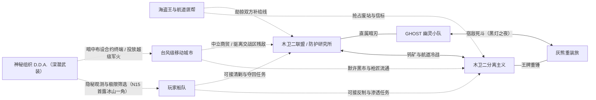

# Deep-Diving Armory（深潜武装）世界观与叙事设定集（World Bible v1.0）

> **定位**：本文档为 DDA（深潜武装）的统一叙事总纲，面向后续任务简报润色、前哨站/台风移动城市 NPC 对话事件（`Missions/event.xml`）、可收集情报日志与装备风味文本编写。  
> **设计原则**：100% 锚定 DDA 现有枪械、弹药材料、交战区地图、合约系统与敌对势力，不推翻已有机制，只把散落的拼图连成活生生的木卫二深海战场。

---

## 一、叙事定调与风格准则

### 1. 核心主题：**深海冷战与军工淘金潮**
木卫二的冰层之下，怪物从未消失，但真正把人类推向深渊的，是人类自己。  
当深渊裂隙中发现了足以改变穿甲与防弹规则的**钨矿**与**钨刚**，一场围绕矿脉、船厂、生产线与航道控制权的“深海军备竞赛”彻底爆发。在这里，政治口号往往只值半个弹匣——真正决定明早还能不能呼吸的，是枪机里有没有进水、胸口插了几级板、以及你的合约能不能换来下一箱复装弹药。

### 2. 基调配比：**80% 硬核深海军事 + 20% 黑色幽默与神秘悬疑**
- **主线与正规阵营（联盟、分离、海盗、台风、六大地标）**：保持贴近原版《潜渊症》的冷峻、务实、略带压抑的军事工业质感。少喊空洞口号，多写补给短缺、舱壁漏水、老兵迷信、枪械保养和派系算计。
- **深潜武装（D.D.A. / 猪咪先辈 / 深潜小队）**：**绝非普通民营公司，而是藏在整场木卫二冷战幕后的神秘黑箱组织**。前期故意保持高度神秘，直到 N15 才揭开第一层帷幕，并把更深的秘密留给后续版本更新：
  - **“草台军火公司”只是绝佳的伪装**：为什么猪咪先辈总把“公司刚上市、缺人招兵买马、这里只是演习”挂在嘴边？因为这是 D.D.A. 最荒诞也最有效的反侦察烟雾弹——把一个拥有越级军工与恐怖战力的地下组织伪装成“连外勤都招不齐的草台小作坊”，既能让联盟和分离高层掉以轻心，又保留了社区独有的轻松反差感。
  - **共享代号与统一面具**：到处可见的“猪咪先辈”是一套反追踪轮值身份，外人永远分不清昨天在莱特城发任务的人和今天在合约室翘脚的人是不是同一个；唯有在他们突然出手支援后辈、或 N15 亮出真本事时，玩家才会意识到这帮爱讲烂梗的家伙到底有多可怕。
  - **留白原则（为后续更新留足余地）**：N15 不是终点，只是玩家拿到“核心入场券”的门槛。真正的幕后“老大”、**《猎潮行动》**到底在防备什么、D.D.A. 的最终目的，都要通过碎片化线索层层递进，留给未来版本持续展开。

---

## 二、宏观世界观：钨刚纪元与深海冷战

### 1. 为什么枪械在木卫二全面复兴？
早期移民在狭小潜艇内极度忌讳热兵器——跳弹、穿壳和气压失衡足以害死全船人。但三大技术拐点彻底改变了深海作战规则：

| 时代阶段 | 标志性装备/材料 | 世界观技术背景 | 对应游戏进程 |
| :--- | :--- | :--- | :--- |
| **旧库时代** | 铅弹、二战旧式步枪/冲锋枪、简易防弹衣 | 早期移民船与殖民地警卫留下的历史图纸，靠廉价硝石与硫磺维持火力，多见于海盗与偏远矿站。 | 浅层海域 / N3 |
| **工程塑料与钢钛时代** | 工程塑料、钢制枪械、钛弹、标准防弹插板 | 抗高盐高压腐蚀的**工程塑料**量产，配合水密枪机与“水中阻力优化”弹头，现代制式步枪正式进入水下 CQB 战场。 | 欧罗巴海脊 / N4–N6 |
| **刚素与模块改装时代** | 刚素/雷刚弹药、GunSmith 枪匠改装、机动护盾、神经调整芯片 | 异星矿脉与旧地球军工图纸结合；前线老兵不再满足于制式枪，开始通过机匣、导气箍、护木和头盔神经接口定制个人武器。 | 高原—无光海原 / N7–N8 |
| **钨刚纪元** | 精炼钨、**钨刚**、贫铀弹、AST-Rivet“坚垒”重装外骨骼 | 仅在无光海原、渊洋、热液废土深渊中出现的**钨矿**被发现。精炼钨与刚素结合而成的**钨刚**硬度胜过钻石，引发穿甲弹与重型装甲的终极对抗。 | 无光海原—热液废土 / N8–N15 |

### 2. 木卫二近二十年编年史（DDA 扩展线）

- **T-18 年｜莱特标准化浪潮**：传奇建筑设计师**泰勒·莱特**主导设计了通用模块前哨站标准，第一座示范城被后人称作**莱特城**。同期，**新伊阿佩特斯超钢船厂**凭“御冬级”潜艇声名鹊起，**阿尔伯利特矿业**建起集采矿、冶炼、销售于一体的深渊工业网。
- **T-11 年｜深渊钨矿与“钨刚”诞生**：阿尔伯利特勘探队在无光海原底部的热液裂隙中发现高纯度**钨矿**。两年后，**联盟防护研究所**成功将精炼钨与刚素融合，命名**“钨刚”**——木卫二材料学迎来转折点。
- **T-8 年｜军工禁运与远港加班潮**：联盟以“防范恐怖主义”为由，宣布对钨矿、高穿弹药和模块化机匣实行配额管制，强行接管阿尔伯利特矿业外围航道。**远港建造厂**三班倒为联盟前线赶制弹药；分离主义则暗中联络旧船厂工人与矿工，走私 AK 体系蓝图与地下复装生产线。
- **T-6 年｜103 船厂停摆与海盗潮起**：因原料被卡与战火波及，新伊阿佩特斯超钢船厂（103 号旧址）被迫停工废弃，船坞里留下一艘未完工的儒艮级潜艇与封存军资。大量失业的矿工、船厂保安和退伍兵流落航道，在一位前矿业保安队长的整合下形成有组织的**海盗武装**。
- **T-4 年｜“黑灯之夜”（战争幽灵之战）**：联盟机密渗透部队 **GHOST（幽灵小队）**突袭分离主义秘密军械点，先切断全站主照明，随后全员启动联盟绝密研发的**热成像干扰器（热成像屏蔽仪）**。分离守军依赖的红外热成像瞄具瞬间沦为盲区，防线几乎崩溃。危急时刻，**灰熊小队**在**传奇大尉**带领下干脆砸碎失灵的目镜，顶着绝对黑暗用曳光弹、闪光雷和燃烧瓶强行打亮走廊，以惨重代价把“隐形”的幽灵轰退——这一战彻底奠定了两支王牌部队的宿敌关系。
- **T-3 年｜台风级移动城市下水**：为躲避日益频繁的前哨站拉锯战，由多方商会与中立工程师众筹改建的巨型移动城市**“台风级”**正式启航。它依靠庞大舰体与自卫舰队游弋冰下，成为黑市、枪匠、佣兵与难民共同的流动避风港，但也成了各方垂涎的肥肉。
- **T-1 年｜外挂接驳舱与“深潜合约”流入战区**：随着各处交战区陷入拉锯，一个自称“深潜武装（D.D.A.）”的神秘黑市金主开始在交战区外围的废弃对接口和声呐盲区，悄悄咬合进一种轻型**外挂式战地接驳舱（雇佣兵口中的“合约室”）**。舱内不仅挂着由先遣侦察员手绘的渗入沙盘与静音水下运载接口，还立着一台直连暗网的**战场遥测对赌终端**（先是“旧约”，后迭代为“猎潮行动”）——独立船队只要自愿刷入苛刻的作战限制并上传实战数据，打完就能换走远超黑市水准的军火补给箱。起初，大家都只把它当成财大气粗的地下军火测试商支起来的战地摊子。
- **T-0 年（当前时间线）｜交战区全面燃起，筛选网收紧**：凯腾堡补给站遇袭、远港建造厂落入敌手、阿尔伯利特矿业陷入拉锯、冰封洞穴出现不明屯兵点。玩家所在的独立船队驶入航道；随着战斗越来越深入深渊，人们开始惊觉——连联盟绝密站点和灰熊重装阵地外围，居然也能提前挂上那座一模一样的接驳舱。而在无数次交火与合约结算的背后，D.D.A. 正冷静筛选着每一支幸存船队，等待有人终于够格触发名为**“渊默深潜行动”**的终极试炼。

---

## 三、势力全景与关系网

### 1. 木卫二联盟（Coalition）& GHOST 幽灵小队
- **公开形象**：秩序维护者、航道立法者、工业标准制定者。武器体系偏北约/西式制式化（M4、HK416、AUG、L85A2、UMP45、USP），后勤充足但官僚气重。
- **幕后核心**：
  - **联盟防护研究所**：负责研发 **AST-Rivet“坚垒”钨刚重装外骨骼**、神经调整芯片、高密度防弹插板，以及令全木卫二狙击手闻风丧胆的**热成像干扰器 / 热成像屏蔽仪（`deep_thermal_interference`）**，视实战数据高于士兵性命。
  - **GHOST（幽灵小队）**：直属联盟高层情报部门的“黑手套”，不挂常规番号（含“无畏先锋”“精确射手”与代号**“灰猎犬”**的追猎单元）。他们之所以被称为“幽灵”，核心正是全员标配的**高度加密热成像屏蔽仪**——该设备通过动态红外干扰与热源抑制，令穿戴者在 1x/6x 热成像瞄具和热成像头盔视野中彻底“蒸发”。配合切断哨站照明与消音渗透，敌人往往直到中弹也看不到半点热信号。由于设备内置生物/硬件加密锁（使用者阵亡即锁死，强拆损毁），即便民间船队或分离主义缴获实物也无法破译复用；唯独两方极少数顶级追猎者靠高阶配发或残缺逆向才能零星启用。其装备蓝图亦被联盟高度加密，极少有目击者生还。
- **叙事矛盾**：联盟确实在维持大多数平民定居点的供电与医疗，但为了垄断深渊钨矿，他们不惜默许幽灵小队清洗“不配合”的矿业工程师和独立船队。

### 2. 木卫二分离主义（Separatists）& 灰熊小队（Grizzlies）
- **公开形象**：反抗联盟垄断与配额剥削的武装同盟。武器体系偏苏/俄系与高可靠性改件（AK-74M、AKM、AK-103、9A-91、PMM），战术凶悍、擅长依托复杂地形打阵地消耗战。
- **王牌核心**：
  - **灰熊小队（Grizzlies）**：分离主义最精锐的重装突击群，编有**政委**（维系士气与纪律）、**主宰**、**机枪堡垒**、**重型榴弹手**以及鲜为人知的**灰熊渗透部队**。作战服采用特制防水面料与内置软质防弹插板，口号务实而血性——“联盟的门再厚，也能拿大口径砸开”。
- **叙事矛盾**：分离主义既有真正为矿工和自由而战的理想主义者，也有为抢夺远港生产线、不惜把平民城市拖入交战区的激进军阀。

### 3. 冰下海盗与“海盗王”航道劫掠网
- **组织形态**：并非乌合之众，而是由失意矿工、逃兵、船厂下岗工人组成的松散掠夺同盟。浅层新兵仍端着二战老枪和低穿铅弹，但深处要塞里的老海盗已能搞到反器材步枪、偷来的联盟制式枪，甚至土法焊接芳纶插板的**海盗重装外骨骼**。
- **运作方式**：专挑信标站、孤立中继站和废弃船厂下手，劫船倒卖给黑市，靠收取“过路税”和绑架赎金维持武装。

### 4. 台风级移动城市与台风舰队
- **组织形态**：由大型航运工会、老牌工程师和自由商团联合运作的巨型水下移动城邦。名称源自潜艇内部庞大的双壳体与重型推进舱结构，旗下拥有自卫性的**台风护航舰队**（地图动态事件中，交战区残敌有时会由台风舰队顺手肃清）。
- **内部生态**：有维持体面的豪华餐厅、令各方忌惮的封存核弹发射井、琳琅满目的**台风大百货**，以及藏在下层维修舱里的枪匠铺和情报交易角。它严格保持政治中立，只认马克和信用——但也因此屡遭各方试图强行截停夺取。

### 5. 深潜武装（Deep-Diving Armory / D.D.A.）—— 冰下的“守门人”与未知变量
- **前期表象（N3–N7，极其接地气）**：在浅层和中层雇佣兵眼里，D.D.A. 一点也不玄学——它看起来就是一家神秘但出手极阔绰的**地下军火测试商 / 战地赌局庄家**。他们在交战区外围架接驳舱、派吊儿郎当的“猪咪先辈”看摊、鼓励佣兵按苛刻条件打仗并上传实战数据，换取高端弹药箱和改装件。大多数船长只管拿货，懒得深究背后是谁掏钱。
- **合约室与深潜终端的硬核物理逻辑**（完全贴合游戏 `Deep_docking` 模块与合约机制，拒绝玄学）：
  1. **合约室 = 外挂式战地桥头堡（`Deep_docking`）**：它并非凭空长在敌方建筑里，而是 D.D.A. 先遣侦察组利用声呐静默涂层，提前咬合在交战区外围废弃对接口或盲区上的**轻型标准接驳舱**。隔离气闸把交战区与接驳舱隔开，守军要么误判它是早已报废的民用货运舱，要么深陷交战无暇顾及外围。
  2. **地图沙盘与“突击行动终端”**：先遣侦察员冒死潜游测绘出的外部渗透航路（压载舱暗道、外墙逃生梯、矿井竖井、跳帮点位），配合舱内配属的小型静音水下运载艇，把独立船队直接送到敌方防线死角。
  3. **深潜合约终端 = 遥测对赌终端 + 外围线路劫持盒**：
     - *限制类词条（禁狙/禁霰/禁爆破/轻装/闪电战/最终防线等）*：本质是**战地装备遥测协议**——刷卡签单后，终端把一次性记录协议写入小队头盔与通讯器，全程核验是否违规或超时，达标即按赔率解锁/空投对应等级补给箱。
     - *战场干预类词条（夜战夺隘/画地为牢/永恒追猎等）*：说明先遣侦察员不仅摸清了路线，还提前在哨站外围配电总线、门禁继电器和通讯中继上埋了跳线——签下“夜战夺隘”，终端直接发过载脉冲拉掉全站主照明；签下“永恒追猎”，终端向敌方精锐频段广播你的高价值伪造信标，主动把追猎者引来咬你。
- **中期细思极恐的违和感（N8–N9，神秘感真正渗出来）**：
  1. **远超普通军火商的渗透力**：前期在海盗老巢门口挂个接驳舱还说得过去；可等玩家打到**联盟绝密 GHOST 占领区**和**灰熊重装旅死守的渊洋前哨**，竟然发现门口同样早已焊好了这座接驳舱，连敌方电网结构和隐秘通风井都标得一清二楚——一个自称“招不到人的小作坊”凭什么拥有比两大政权情报部更恐怖的先遣网？
  2. **查不到源头的技术溢出**：压弹机工艺、GunSmith 通用改装框架、甚至部分比联盟防护研究所更早流出黑市的插件，都带着抹去序列号的 `D.D.A.` 隐形钢印。
  3. **两大政权反常的沉默**：无论是联盟艾琳上校还是灰熊传奇大尉，谈起那座外挂接驳舱和“猪咪先辈”时，态度都不是轻蔑，而是刻意回避与隐隐忌惮。
- **N15 揭晓的第一层真相（与更深的留白）**：
  - 所谓“地下军火测试商 / 准备上市的小公司”只是他们用来糊弄外界的烟雾弹。真正的 D.D.A. 是一个跳出联盟与分离内耗的**独立深渊武装结社**，手下藏着战力远超常规王牌的**深潜一至六队**。
  - 遍布航道的接驳舱和合约终端，实则是他们铺设的**全卫星战力盲选网**：既用实战数据催熟轻武器与防具工艺，又把真正能在绝境里活下来的船队筛出来，放进**《猎潮行动》**名单——以防备连两大阵营高层都在刻意隐瞒的深渊异变（**“潮汐 / The Tide”**）。
  - 至于神秘的“老大”究竟是谁、D.D.A. 的总基地藏在冰层哪处、深潜小队最初是从哪场浩劫里幸存下来的，**在 N15 结束时依然只抛出线索、不给终极答案**，为模组后续版本更新留出充足的叙事空间。

---

## 四、六大核心地标档案（从战前咽喉到交战区）

| 地标名称 | 战前身份 | 如今的战场格局与叙事钩子 |
| :--- | :--- | :--- |
| **莱特城（Latte）** | 泰勒·莱特设计的通用模块示范城，曾是木卫二宜居典范 | 中央大厅四通八达却成了死亡交叉火力区；东西双狙击长廊与消防通道里仍贴着战前的民用疏散海报。 |
| **阿尔伯利特矿业中心（Mining）** | 集深渊采矿、精炼、销售于一体的老牌矿业巨头总部 | 钨矿战争的**第一块多米诺骨牌**。东西两座矿物升降梯至今还能运转，上层长廊曾是高管观景台，如今是狙击手最爱的猎场。 |
| **新伊阿佩特斯超钢船厂（103 废弃船厂）** | 打造传奇“御冬级”潜艇的老牌造船厂 | 停产后被彻底改造成地下军火库与碉堡，残垣断壁间停着一艘**永远没能下水的未完工儒艮级潜艇**，藏着当年失踪的 GunSmith 精密模具线索。 |
| **冰封据点（Frozen Armory）** | 低温冰窟中鲜有人涉足的科考前哨 | 因其极寒水域能屏蔽常规声呐探测，被改造为秘密屯兵与武器中转站，内部极度狭窄，专打窒息级短兵相接。 |
| **远港建造厂（Farport）** | 木卫二最具盛名的综合军工与潜艇建造枢纽 | 战火未彻底毁掉它的产线，反而让它成了最值钱的战利品。二十余米无护栏外墙、通信塔逃生梯与监控室，造就了木卫二最残酷的立体狙击战。 |
| **台风级移动城市（Typhoon）** | 游弋冰下的中立移动商业城与避难所 | 和平时是玩家最好的补给与改枪港湾；被截停攻占时则是包含**核弹发射井、豪华餐厅、压载舱暗道**的多层立体跳帮炼狱。 |

> **补充地标呼应**：**凯腾堡补给哨站**（航线咽喉，多次在联盟与分离之间易手，详见任务“兵戎相见”）以及散布各航道的**废弃信标站**（画皮与“捕蟹人”传说的温床，同时也是海盗王的临时落脚点）。

---

## 五、五幕主线故事线 + 三条特色支线

整条主线与玩家从浅层到深渊、从 N3 到 N15 的成长曲线严密咬合，且**允许玩家以独立雇佣兵身份在联盟与分离之间做选择**，不强制锁死阵营。

### 主线五幕：《冰下口径》

#### 第一幕｜浅层硝烟：火药、铁皮与海盗王（寒冰洋 · N3–N5）
- **对应任务**：开采硝石/硫磺、短兵相接（适中/困难）、摧毁海盗临时据点/据点/要塞。
- **剧情脉络**：
  - 玩家船队刚进入战区外围，发现常规弹药价格暴涨，前哨站急缺基础火药原料（硝石、硫磺）。同时，一位自称**“猪咪先辈”**、嘴上总念叨着“王道征途”和“小作坊缺人手”的古怪线人主动搭话，塞来几单报酬奇高的委托。
  - 随着玩家连续端掉海盗据点并在信标站缴获海盗首领的**加密硬盘**，一个反常事实浮出水面：这帮端着二战老枪起家的海盗，竟开始装备成批钢制步枪、反器材武器和私改外骨骼，且对联盟补给航线了如指掌。
  - **自然留下的碎片（不挑明）**：台风城枪匠陈墨在验枪时随口吐槽某批导轨“公差像六年前沉没的远港三号车床铣出来的”；矿工私下嘀咕今年浅层冰壳异响提前；海盗硬盘里除了指向**远港**和**103 船厂**的走私坐标，只提了一嘴外围废弃对接口半夜被焊上了一座挂着 `0041` 编号的静音接驳舱。

#### 第二幕｜断链的工厂：两条战线的夹缝（欧罗巴海脊 · N6–N7）
- **对应任务**：兵戎相见（凯腾堡/机密文件）、消灭残留分离部队、肃清分离主力、消灭联盟军。
- **剧情脉络**：
  - 航道进入正规军交战区。联盟的**艾琳·斯特林上校**雇佣玩家夺回被分离主义占领的**凯腾堡补给站**与**远港/矿业外围哨站**，并潜入保险箱截获分离主义加密文件；分离主义联络人也重金悬赏玩家拔除联盟封锁站。
  - 通过台风城的商人和枪匠之口，玩家了解到**阿尔伯利特矿业中心**的钨矿争夺战已彻底失控——联盟和分离都在抢夺**远港建造厂**的产线与**103 船厂**的旧模组。
  - **自然留下的碎片（不挑明）**：103 船厂的核销单显示，那台登记沉没的车床早在停产前 48 小时就被查无此号的“深潜物流 `EU-0041`”提走；远港停产前强制转产穿甲弹与插板的调度令上，加急事由莫名其妙地写着 **`[备汛·最高优先级]`**；合约室的先辈顺嘴说自己刚从 103 船厂倒班过来——可那条航道当时已被联盟水雷封死了整整三天。

#### 第三幕｜黑灯与灰猎犬：钨矿之下的暗影（无光海原 · N8）
- **对应任务**：“幽灵行动”（极度困难）、合约《永恒追猎（幽灵）》。
- **剧情脉络**：
  - 玩家首次潜入无光海原的深渊边缘采集钨矿，撞见一座死寂的哨站——里面的分离守军和增援部队在一夜之间被无声屠戮。分离主义前线指挥官罕见地向独立船队低头求援，悬赏清除盘踞站内的 **GHOST（幽灵小队）**。行动中，代号**“灰猎犬”**的追猎组长在无线电里全程追踪猎杀。
  - **自然留下的碎片（不挑明）**：先辈在战前不经意叫出了连联盟军官都无权知晓的绝密代号“灰猎犬”；而在幽灵首领箱中缴获的研究所抄件里，联盟自己惊恐地记录着——黑市流出的 `0041-D` 神经接口底层算法竟与 GHOST 现役固件同源，且**版本比军方还高两代**；同时还夹着一份被联盟红章驳回的紧急邮件（关于第 7 批神经芯片在深渊低频波下驱动脑死亡受试者扣动扳机的异常记录）。

#### 第四幕｜铁幕重锤：弱肉强食的真相（渊洋 · N9）
- **对应任务**：“弱肉强食”（噩梦）、合约《战争幽灵》。
- **剧情脉络**：
  - 幽灵折戟后，分离主义把王牌 **灰熊小队**推上最前线。**传奇大尉伊万**与**政委娜塔莉亚**率领主宰与机枪堡垒吃下多个要冲，向靠近的潜艇发出傲慢战书。
  - **自然留下的碎片（不挑明）**：传奇大尉并不会替玩家科普什么天文灾难，他只在残存录音带里借着酒劲骂出当年“黑灯之夜”撞见的诡异一幕——幽灵在撤离前用铝热剂疯狂焚烧的根本不是军火，而是从 14 号矿井捞上来的三具穿着旧外骨骼、脑袋已烂却还死死攥着枪抽搐的“死人”。把大尉的醉话与台风号轮机日志（十七年潮汐斜率）、远港 `[备汛]` 单、废弃信标站医生关于“会换弹的武装画皮”录音拼在一起，玩家自己就会脊背发凉。

#### 第五幕｜渊默深潜：3 秒切错频段（热液废土 · N15 · 第一季终章）
- **对应任务**：“渊默深潜行动”（绝境）、深潜合约终极挑战。
- **剧情脉络**：
  - 抵达热液废土边缘，**猪咪先辈**依然用最离谱的口吻邀请玩家参加所谓“开业大酬宾模拟演习”，信誓旦旦地保证“地上的断肢和血迹全都是全息番茄酱”。
  - 可当玩家踏入交战区、直面装备工艺领先全木卫二半个世代、战力凌驾于幽灵与灰熊之上的**深潜一至六队**五波地狱围攻时，哪怕没人说破，玩家也能用身体感受到真相。
  - **揭晓与留白（绝不做长篇说教）**：熬过五波车轮战后，无线电里没有任何人出来发表组织宣言——只是通讯器**意外切进了 3 秒钟毫无感情的加密内线汇报**：*“……第 6 组火力压制结束。目标船队生还，高强度脉冲干扰下未检出神经共振排异反应。样本确认移入《猎潮》预备名单，签发黑卡——”* 随后一声急促按键，先辈慌忙切回嬉皮笑脸的口吻敷衍称“切错频段了，隔壁放广播剧呢”，把黑卡与箱子丢给玩家，留下一句*“以后在下面听见奇怪的涨潮声，记得刷卡，老大请你喝一杯”*。所有前期散落的 `0041`、接驳舱、遥测合约与深渊异动，在这一刻由玩家自己豁然贯通。

> **详细碎片物证与交叉印证表**：见配套文档 [DDA_Hidden_Threads_Blueprint.md](file:///Users/sherd/Library/Application%20Support/Steam/steamapps/common/Barotrauma/Barotrauma.app/Contents/MacOS/LocalMods/Deep-Diving-Armory/docs/lore/DDA_Hidden_Threads_Blueprint.md)。

---

### 三条可并行支线（丰富探索与日常跑图）

1. **支线 A：《103 船厂的模具》（GunSmith 枪匠线）**
   - **触发**：在台风级移动城市与首席枪匠**陈墨**对话。
   - **脉络**：陈墨年轻时曾在远港与新伊阿佩特斯 103 船厂参与通用导轨和精密机匣模具研发。战乱爆发后，一批高精度枪械模具和未完工儒艮级的火控蓝图被锁死在 103 废弃船厂里。玩家帮他找回零件或清理船厂据点，不仅能解锁关于“为什么木卫二的 AR 和 AK 配件能混用同一套导轨”的硬核幕后故事，还能获得稀有配件/升级工具奖励。
2. **支线 B：《木卫二睡前故事：捕蟹人电台》（深海怪谈线）**
   - **对应任务**：沉船清理、木卫二睡前故事（画皮信标站）、遗迹之声（画皮遗迹）。
   - **脉络**：把现有的**木卫二广播电台**塑造成一个总爱在频道里播报夸张灵异节目的三流电台主持人（代号“夜航者”）。玩家每次听着他的夸大播报去清理画皮信标站、丘脑运输船和异星遗迹，都会在尸体旁捡到真正细思极恐的日志碎片——原来“捕蟹人”不是怪物，而是早期穿着实验型重装外骨骼、却在深渊被画皮寄生融合的失踪矿工小队。
3. **支线 C：《截停“台风”的暗流》（移动城市悬疑线）**
   - **触发**：在台风级移动城市与**玛尔塔**或**霍尔姆舰长**闲聊，并衔接台风交战区地图。
   - **脉络**：台风级移动城市之所以屡次遭到精准截停，是因为城内有人持续向外泄露它的航线与压载舱检修排班。玩家通过在台风大百货、下层引擎室和废弃信标站收集蛛丝马迹，逐步揭开联盟激进派、分离走私贩与海盗线人三方盯上台风核弹发射井的暗斗。

---

## 六、常驻与关键具名 NPC 群像档案

以下 10 位核心角色覆盖了**台风城常驻功能 NPC、深潜武装线人、联盟/GHOST、分离/灰熊、海盗**五大阵营，可直接用于编写对话树、任务简报发件人及战斗无线电喊话。

### A. 台风移动城市与中立线（日常高互动）

#### 1. “扳手”陈墨（Chen Mo）—— 台风城首席枪匠
- **身份与位置**：台风级移动城市机械/军械区常驻 NPC（未来可承接 GunSmith 引导、改枪委托与配件交易）。
- **外貌与装备锚点**：深色沾油工装、护目镜推在额头上，腰间永远挂着游标卡尺、改锥和一把亲手魔改到面目全非的短管 HK416/AK 混合测试枪。
- **性格与背景**：40 多岁，曾是**远港建造厂**和**103 超钢船厂**的精密枪械技师，脾气倔、洁癖仅限于枪膛。他最讨厌两件事：一是外行把泥沙带进导气箍，二是政客把好钢浪费在劣质批量货上。台风城建成后，他带着两箱私藏模具搬上了船，谁给马克就帮谁修枪。
- **标志性台词**：
  - *“别拿联盟那套标准配件手册跟我讲道理。在两千米水压下，卡壳半秒就够画皮把你肋骨拆下来当笛子吹了——枪得按你的手改，不是让你去迁就枪。”*
  - *“103 船厂？哼，我离开那天，那艘儒艮的龙骨还没焊完。要是你去那儿清场，顺手看看西侧货架底下还有没有我的导轨夹具。”*

#### 2. 玛尔塔·沃斯（Marta Voss）—— “台风大百货”掌柜
- **身份与位置**：直接对应现有 NPC `deep_mobile_city_typhoon_shop`（头衔：`台风大百货`）。
- **外貌与装备锚点**：棒球帽、乘务长外套、腰后藏着一把装满 9×19 弹匣的 USP（完全贴合 `DeepNPC.xml` 现有配置！），柜台后堆着贴满不同阵营封条的弹药箱。
- **性格与背景**：精明、嘴碎、消息灵通到可怕的“深海包打听”。她不在乎你刚端掉的是联盟站还是分离站，只在乎你带来的战利品成色够不够新、弹匣有没有压满。她在联盟、分离和海盗手里都有过账，是玩家获取各交战区八卦与传闻的最佳窗口。
- **标志性台词**：
  - *“欢迎光临台风大百货！先说好，带着海盗血渍的防弹板打八折收，带 GHOST 编号的……嘘，那玩意儿拿去里间聊，别让门口巡逻的看见。”*
  - *“最近远港的货又断了，复装弹药箱一天一个价。听姐一句劝，早点囤几箱铅弹和钛弹，等打到无光海原，马克可挡不住子弹。”*

#### 3. 维克托·霍尔姆（Viktor Holm）—— 台风级移动城市轮值舰长
- **身份与位置**：台风城舰桥/行政区常驻 NPC，可发布清理周边交战区或调查台风航线泄密的委托。
- **外貌与装备锚点**：洗得发白的旧船长制服、随身烟斗与一把老式 .44 马格南左轮，眼袋极深。
- **性格与背景**：曾是联盟海军护航舰长，因拒绝在平民区执行焦土炮击令而退役，受聘执掌“台风级”。他深知台风号之所以没被吞并，全靠“中立商业价值”和船体东北方那座**永远处于待机状态的旧式核弹发射井**带来的威慑。他沉稳、疲惫，对所有真正靠本事活下来的船长抱有敬意。
- **标志性台词**：
  - *“台风号不是战舰，它只是三千个不想替政客送死的人拼出来的浮冰。你可以来这里喝酒、改枪、修船，但只要在我的甲板上掏枪，护航舰队会让你见识什么叫‘移动城市的规矩’。”*
  - *“那些贴着 `D.D.A.` 标牌的货箱？我只知道他们从不在台风号上闹事，而且给的港务费永远比市价高三成——只要不碰我的核弹井，我不问货是从哪儿来的。”*

---

### B. 神秘组织 D.D.A. 线（前期迷雾，N15 初现真容）

#### 4. “猪咪先辈”（轮值代号 / 表层对接人）—— 深潜武装外勤观察员
- **身份与位置**：对应现有 `deep_pigcat_easy`、`deep_pigcat_medium` 及合约房常驻的 `deep_pigcat_contract_room_pirate`。
- **外貌与装备锚点**：极具辨识度的猪咪先辈涂装与装备（既有立绘 `pigcat_1` / `pigcat_contract_room`），眼神似笑非笑，语气永远像刚睡醒的摸鱼员工。
- **性格与背景**：**全作反差感最强的神秘人物（群体）**。前期无论玩家怎么追问，他都会用极其离谱的借口把话题岔开——一会儿说“公司刚起步穷得招不到人”，一会儿说“只是给后辈发点王道征途的零花钱”。可细心的玩家会逐渐发现破绽：为什么他总能比联盟侦察船更早出现在交战区？为什么他随手开出的红箱/金箱里装着连联盟研究所都眼红的钨刚升级工具？为什么他喊着“来啊子弹打在胸上”冲进火线时，枪法稳得像怪物？直到 N15，玩家才会明白——**“猪咪先辈”不是草台社畜，而是冰下最危险结社用来迷惑全木卫二的滑稽面具**。
- **标志性台词**：
  - *（N3–N7 摸鱼装傻）“别问啦，问就是草台小作坊，老大还在招兵买马中（悲）。刚从 103 船厂换班游过来脚还凉着呢，快选单子吧！”*
  - *（N8 脱口而出的马脚）“今天值班的是‘灰猎犬’那个面瘫，你签追猎合约可别背对着通风井……嗯？我刚才说什么了？我是说外头那只灰毛海狗啦！”*
  - *（N15 通关后，3 秒冷血内线切错频段之后的慌忙圆场）“卧槽切错频段了！刚才那是隔壁放的广播剧！恭喜通过开业大酬宾模拟演习，黑卡放箱子里了——以后在下面听见奇怪的涨潮声，记得刷卡，老大请你喝一杯。”*

---

### C. 木卫二联盟与 GHOST 线

#### 5. 艾琳·斯特林（Eileen Sterling）上校 —— 联盟战区作战协调官
- **身份与位置**：联盟军事前哨站/行政区任务发布者（串联清剿海盗、夺回凯腾堡、肃清分离主力与远港反攻）。
- **外貌与装备锚点**：笔挺的联盟行政/军官制服、战术平板，从不摘下的加密通讯耳麦。
- **性格与背景**：典型的联盟技术官僚式军人：说话滴水不漏、极度强调“不要使用舰炮摧毁可复用基础设施”，给钱痛快、纪律严明，但内心把独立船队视为“性价比最高的可消耗外包资产”。玩家越深入深渊，越能察觉她对 GHOST、防护研究所以及来历不明的 `D.D.A.` 终端都讳莫如深。
- **标志性台词**：
  - *“我再重申一遍：联盟付给你们马克，是为了完整收回哨站与产线，不是为了看你们拿舰炮把几百万的反应堆炸成废铁。干净点进去，干净点清场。”*
  - *“外围对接口挂着的那座灰壳子接驳舱？听说是一帮搞黑市军火测试的疯子焊上去的。只要他们不炸我的船坞，我管不着你们在里头签什么卖身合约——但上面交代过，军方人员不准去碰他们的终端，也别去打听谁在给他们供货。”*

#### 6. 代号“灰猎犬”（Greyhound）—— GHOST 幽灵小队追猎组长
- **身份与位置**：直接脱胎于现有词条（`deep_balance_contract_eternal_hunt_ghost`：“灰猎犬报告，我已发现他们的足迹……”），作为幽灵行动与追猎合约的核心反派声音/精英首领。
- **外貌与装备锚点**：防眩护目镜+骷髅/幽灵面罩定制 FAST 头盔、高倍率拾音耳机、腰际常亮微弱蓝灯的**加密热成像屏蔽仪（`deep_thermal_interference`）**、消音西式卡宾枪与轻量化隐匿背心。
- **性格与背景**：从不透露真名、语调低沉冷静得像一台声呐测距仪。他是“熄灯+热屏蔽”单向透明猎杀战术的极致信徒——在对手的热成像瞄具里完全隐形，却能靠高倍率拾音耳机听清隔墙的心跳与换弹声，对灰熊小队在“黑灯之夜”用蛮力烧穿他隐匿优势的旧疤耿耿于怀。
- **标志性台词**：
  - *“把你那破热成像关了吧，里面什么都不会有。你唯一能听见的，只有自己吵得像反应堆一样的心跳……灰猎犬已锁定气味，他们不会活着离开这里。”*

#### 7. 马库斯·哈兰德（Dr. Marcus Harland）—— 联盟防护研究所外派顾问
- **身份与位置**：联盟科研站/高级补给事件 NPC，负责解释**钨刚、AST-Rivet“坚垒”外骨骼、热成像屏蔽仪**与**神经调整芯片**的技术背景。
- **外貌与装备锚点**：白大褂外直接套着轻型防弹背心，镜片永远反光，随身携带芯片烧录仪与一台无外壳的热屏蔽测试模块。
- **性格与背景**：狂热的材料、光电隐匿与神经工程学家，沉迷于突破单兵在深海交火中的感知不对等优势。他并不邪恶，却有一种令人毛骨悚然的学术冷漠——在他眼里，一场惨烈的哨站攻防只是“钨刚插板与热成像屏蔽仪的田野实验”。
- **标志性台词**：
  - *“头盔里的神经调整模块会让你在一秒内完成平时需要三秒的肌肉记忆——至于术后轻微耳鸣和梦魇？相比被 7.62 钨刚弹打穿面罩，这点副作用微不足道。”*
  - *“别白费力气拆解 GHOST 身上的热成像干扰器了。我亲自设计的底层权限锁，没有活体神经密钥，它在你手里就只是一块昂贵的废铁。”*

---

### D. 分离主义与灰熊线

#### 8. “传奇大尉”伊万·莫罗佐夫（Capt. Ivan Morozov）—— 灰熊小队灵魂指挥官
- **身份与位置**：直接脱胎于现有词条（`deep_balance_contract_ghosts_of_war` & `deep_grizzlies_reinforce_20min`），灰熊重装旅的旗帜人物。
- **外貌与装备锚点**：满是弹痕的灰熊防水重甲、面罩拉起时能看见浓密胡茬与一道从眉骨划到下巴的旧疤、肩挂大口径重机枪/改装 AK，胸挂里除了弹鼓永远塞着一只扁铁酒壶。
- **性格与背景**：豪迈、粗粝、护短且极富战术智慧的老兵。当年他原是阿尔伯利特矿业重型工程队的爆破总管，因目睹联盟封锁导致整座矿区缺氧封舱而彻底倒向分离主义。他最敬重敢正面硬碰硬的对手，最鄙视躲在暗处切电闸的幽灵小队。
- **标志性台词**：
  - *“你问当年黑灯之夜我们怎么干翻幽灵小队的？同志，准备好伏特加，我们边喝边聊——简单说，他们关了灯，我们就把整条走廊用曳光弹和燃烧瓶点亮！”*
  - *“又一艘潜艇靠港了？哈，看来不是软脚虾！大兵们，上好钨刚弹链，别怠慢了远道而来的客人！”*
  - *“外头对接口那帮躲在铁罐子里发‘合约’的鼠辈……哼，连我们刚接管的渊洋据点外墙都能被他们摸透线路、顺手拉闸，绝不是什么小打小闹的军火贩子。箱子你们尽管拿，但最好别让我查出他们站哪边！”*

#### 9. 政委 娜塔莉亚·科瓦廖娃（Commissar Natalia Kovaleva）—— 灰熊政治委员
- **身份与位置**：对应 `deep_grizzlies_political_commissar`，灰熊小队的副手与分离主义高阶任务联络人。
- **外貌与装备锚点**：深绿灰熊作战服、鲜明袖章、手枪与加密通讯器，在战场上以稳住阵线、激励重装小队著称。
- **性格与背景**：冷静、犀利、信念坚定，与伊万大尉的豪爽形成互补。她清楚分离主义内部并非铁板一块，因此极力维持灰熊小队的纪律性，不让部队沦为另一伙海盗。她对独立船队态度务实：只要你能帮分离打破联盟封锁，报酬绝不克扣。
- **标志性台词**：
  - *“联盟管我们叫叛军，可这冰盖底下每一米管道都是矿工拿命焊出来的。我们抢远港不是为了毁掉它——是为了让普通船队也能买得起不被垄断的子弹。”*

---

### E. 海盗与暗网线

#### 10. “铁颚”萨姆（"Ironjaw" Sam）—— 浅层航道“海盗王”
- **身份与位置**：对应任务“短兵相接（困难）”与海盗要塞幕后统领（`deep_pirate_leader_hard` 的具名化升级）。
- **外貌与装备锚点**：焊着厚重芳纶防破片插板的自改海盗外骨骼，下巴曾被炮弹破片撕裂后换上了粗犷的金属护颚。
- **性格与背景**：前阿尔伯利特矿业护卫队长，公司被联盟接管后遭拖欠抚恤金并被通缉，一怒之下带着旧部占了信标站起家。他是个务实的法外之徒，懂得用老旧二战武器武装新兵当炮灰，用抢来的好货养精锐；虽然狠辣，却意外地讲究“收了过路费就不杀平民船”的江湖规矩。
- **标志性台词**：
  - *“联盟说我是海盗？他们拿一张盖章纸就抢走了一整座矿山，我不过是拿枪把欠我们的利息一船一船收回来罢了！”*

---

## 七、潮汐架构与后续版本扩展接口（N15+ 长线更新预留）

为了保证 DDA 后续不断更新新地图、新敌对势力、新合约赛季或更高难度战役（N16+）时故事永远“有钩子可接、不吃书、不写死”，并能灵活适配《潜渊症》未来官方 DLC 内容，现阶段对核心悬念**“潮汐（The Tide）”**采用**“硬科幻天灾底座（D）+ 双重深渊威胁弹性接口（A / B）”**的分层设计：

### 1. “潮汐（The Tide）”暂定三层结构（D + A/B 弹性预留）
- **硬科幻底座｜木星周期性极端引力大潮（方案 D，已定调）**：
  - 每隔十几年，木星引力叠加效应会引发木卫二冰下极端引力潮汐，撕裂深渊海床、冲垮部分固定航道与前哨站，同时把平时埋在千米岩层下的**巨量高纯度钨矿、失踪潜艇残骸与旧时代封存设施**翻涌到热液废土表面。
  - 这既是冲垮旧秩序的深海大灾变，也是引发联盟、分离、海盗与独立船队全面涌入深渊厮杀的**“血色大潮窗口”**。D.D.A. 提前算出了大潮倒计时，才在全木卫二铺开接驳舱与《猎潮行动》筛选网。
- **伴生威胁弹性接口（方案 A & 方案 B，待官方 DLC 落地后最终拍板或并行保留）**：
  - **方向 A｜铁潮 · 神经残响**：大潮伴随的深渊异星低频共振波，能够强行重启/劫持死在深渊矿区与战场中的**早期神经调整芯片及重装外骨骼**，形成沉默无声、无线电只循环生前求救杂音、却保有致命枪战肌肉记忆的“沉溺铁军”。
  - **方向 B｜黑潮 · 装甲画皮**：大潮把深渊沉骸与联盟防护研究所失控的生物抗压实验体一并卷向浅层——披着残破防弹插板与重型外骨骼、仍保留扣扳机本能的**武装画皮进化体**（正好回收“捕蟹人”怪谈伏笔，并极致发挥 DDA **虚拟弹匣“钨刚破甲 + RIP 空尖撕肉”混装弹序**的战术魅力）。
  - **当前叙事处理策略**：在 N3–N15 的碎片日志和 NPC 传闻中，**同时埋下“引力大潮前兆”“早期神经芯片异常杂音”和“穿外骨骼的变异画皮目击报告”三条草蛇灰线**，但绝不提前锁死哪一条是唯一元凶——未来官方 DLC 发布后，随时可以顺着最契合 DLC 的那一条正式收束，其余线索自然降格为局部支线事故，完全不吃书。

### 2. 四大长线版本扩展接口

| 预留接口 | 前期已埋伏笔（N3–N15） | 后续版本可直接展开的方向 |
| :--- | :--- | :--- |
| **接口 1：《猎潮行动》的真正主战场** | 新版合约终端名为“猎潮行动”；幽灵评估记录提到“大潮来临时存活率低于 12%”；渊洋底层出现引力异常、低频杂音与装甲画皮目击。 | 未来可推出**大潮期特殊交战模式**（震动/断电/多方混战抢矿撤离），并视官方 DLC 方向正式引入**残响铁军（A）**或**装甲画皮大潮（B）**作为 N16+ 终局敌群。 |
| **接口 2：神秘“老大”的三重矛盾传闻** | 猪咪先辈和黑市文档里只叫他“老大”，但民间流传着三种完全不同的说法：① 失踪多年的传奇建筑大师**泰勒·莱特**；② 从联盟防护研究所盗走第一份钨刚与神经接口底稿的“窃火者”；③ 根本不是一个人，而是由几位旧时代舰长组成的匿名委员会。 | 未来任意版本想正式放出 Boss 级或盟友级领袖角色时，可直接钦定其中一条（甚至设计反转），前期三种传闻自然成为绝佳的烟雾弹。 |
| **接口 3：玩家 N15 后的“黑卡特约身份”** | N15 结束后玩家获得加密通行凭证，从“被合约筛选的外人”晋升为“有资格坐在牌桌边的编外行动队”。 | 未来新增**D.D.A. 秘密中继站/黑市隐蔽据点**、高阶专属枪匠蓝图、甚至“与深潜小队某一分队并肩作战”的新任务类型时，完全不需要重新解释门槛。 |
| **接口 4：D.D.A. 内部裂痕 / “失联分队”** | N15 出场的是深潜一至六队，但终端序列号里偶尔能看到被涂黑的**“零号协议”**或叛离记录。 | 如果未来想做一套**比幽灵和灰熊更狠、甚至与 D.D.A. 本部理念决裂的新敌对精锐阵营**（比如主张在大潮中彻底清洗两大政权的激进派），可以直接从这里切入。 |

---

## 八、分阶段落地进游戏的轻量化路线图

为避免一次性改动面过大，建议按“玩家最先感知、改动风险最低”的顺序分三期落进游戏 XML：

### 第一期（纯文案 + 轻事件，最快见效）
1. **重润色现有任务简报**（[chinese.xml](file:///Users/sherd/Library/Application%20Support/Steam/steamapps/common/Barotrauma/Barotrauma.app/Contents/MacOS/LocalMods/Deep-Diving-Armory/text/chinese.xml)）：保留所有红绿蓝数值情报提示，把开头的“某长官/某指挥官”替换为具名发件人（艾琳上校、娜塔莉亚政委、传奇大尉、铁颚萨姆等），并调整 N15 结尾文案，把“成立公司”改为“揭开面具一角、发放黑卡邀请”的悬念收尾。
2. **激活“台风级移动城市”对话**：给现有 `deep_mobile_city_typhoon_shop`（玛尔塔）和新增的枪匠**陈墨**、**霍尔姆舰长**挂上可循环闲聊事件（`Missions/event.xml`），玩家停靠台风城时既能打听六大地标传闻，也会零星听到各方对 `D.D.A.` 终端的忌惮。
3. **升级“猪咪先辈”合约房对话**：前期依然保留他满嘴“草台小公司/招兵买马”的装傻幽默，同时埋下不经意漏出的高权限细节（例如随口报出连联盟都没公开的战区动向）。

### 第二期（碎片化叙事，极低成本高沉浸）
1. **战场可拾取情报日志（Paper / Logbook 物品）**：在六大交战区地图与海盗/幽灵/灰熊首领身上概率掉落 12–15 份简短档案（如《阿尔伯利特深渊钨矿初探备忘》《黑灯之夜幸存者录音转写》《103 船厂停工封存清单》《联盟关于禁止拆解 D.D.A. 终端的保密电报》《GHOST 战术评估评分残页》），既可阅读也可卖给玛尔塔换马克。
2. **标志性装备风味词条补全**：为钨刚、神经调整芯片、AST-Rivet“坚垒”、GHOST/灰熊套装与几把代表性 GunSmith 武器补充一两句“出自谁手/背后的故事”。

### 第三期（剧情事件链与轻分支）
1. **三段式轻量支线事件**：先从《103 船厂的模具》（陈墨）或《截停“台风”的暗流》（霍尔姆舰长）试水，利用《潜渊症》原生 `ScriptedEvent` + `ConversationAction` + `MissionAction` 实现，不引入复杂 C# 状态机。
2. **宿敌无线电播报增强**：在“幽灵行动”“弱肉强食”“海盗要塞”与 N15“渊默深潜行动”的增援节点，把通用提示语升级为“灰猎犬”、传奇大尉、政委、铁颚萨姆与深潜六支分队的专属无线电喊话。
